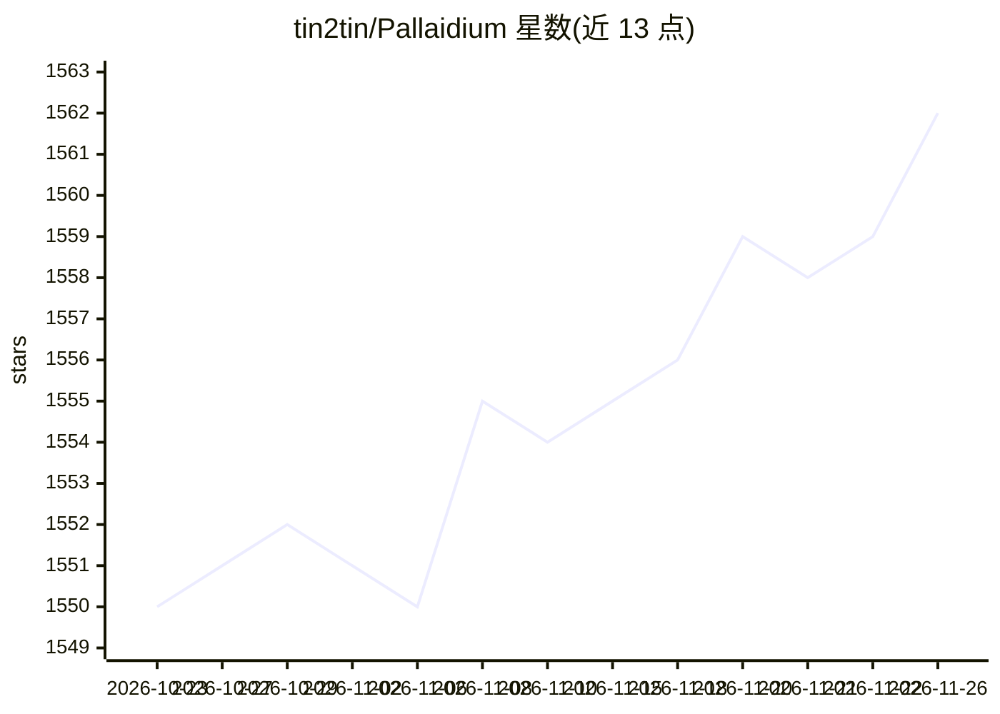

# tin2tin/Pallaidium

⭐ 1,562 · Python · GPL-3.0 · 推送 2026-11-25 · [GitHub](https://github.com/tin2tin/Pallaidium) · [官网](https://tin2tin.github.io/Pallaidium/) · 个人维护

**集成于 Blender VSE 的生成式 AI 电影制作插件**

以 Blender 视频序列编辑器（VSE）插件形式提供的生成式 AI 工作流：支持文本/图像/视频到图像、视频、音频、音乐、语音、文本的转换，覆盖 ControlNet、IP Adapter、LoRA、批量生成与渲染队列等功能，生成结果自动加入时间线。默认本地运行模型，可选通过 OpenAI /v1 兼容协议连接 ComfyUI、fal.ai、LocalAI 等远程后端。要求 Windows（Linux 有限支持）、Blender 5.2+、支持 CUDA 的 Nvidia 显卡。

## 筛选速览

| 维度 | 判定 | 备注 |
|---|---|---|
| AI 角色 | `ai-native` | 本体是模型或模型工具 |
| 许可风险 | `dual` | GPL-3.0 |
| 部署形态 | `desktop` | 安装包/桌面程序 |
| 模型依赖 | — | README 未给出锁定关系 |
| 硬件要求 | `gpu-8g` | |
| 安装摩擦 | `medium` | 含编译或系统依赖之一 |
| 成熟度 | — | 结构信号不足 |

## 能力要点

- 文本/图像/视频到图像、视频、音频、音乐、语音、文本的生成矩阵
- 生成结果自动添加到 VSE 时间线，支持批量处理与渲染队列
- 可选远程后端：OpenAI /v1 兼容协议，内置 ComfyUI/fal.ai/LocalAI 连接器，支持自定义连接器
- 一键安装/卸载依赖，模型权重经 Hugging Face 缓存管理

## 适用场景

- 从歌词或场景描述生成带分镜的剧本并生成画面、配音、音乐
- 对 VSE 时间线上的片段做批量图像/视频生成与精修
- 把生成任务卸载到远程 ComfyUI 或云端后端运行

## 场景标签

`图像生成` `视频生成` `语音合成` · 领域:内容生成

## 证据(README 行号)

> L3:  A free generative AI movie studio integrated into the Blender Video Editor.
> L14: Pallaidium turns that insight into a workflow. Prototype the full production cycle with AI before committing to a s
> L124: Pallaidium runs models **locally** by default. Optionally, it can also drive an

## 星数曲线

2026-10-23 1,550 → 2026-11-26 1,562（+12）

---
*卡片 v1 · prompt 1.4 · 生成 2026-11-26 · 置信度 high · 依据 README sha `d8f7ca1e447e` · [字段定义](../../DATASET.md)*
