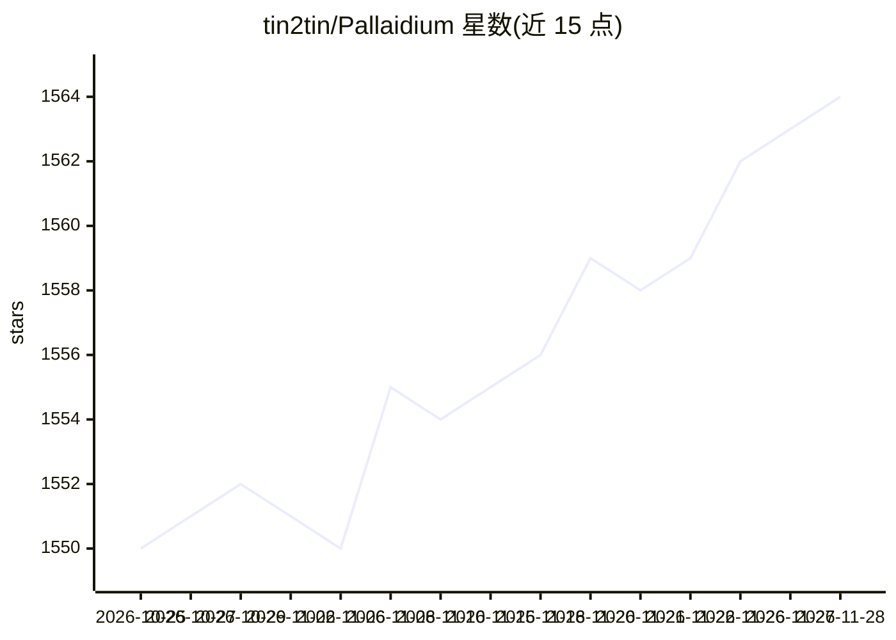

# tin2tin/Pallaidium

⭐ 1,564 · Python · GPL-3.0 · 推送 2026-11-27 · [GitHub](https://github.com/tin2tin/Pallaidium) · [官网](https://tin2tin.github.io/Pallaidium/) · 个人维护

**集成于 Blender 视频编辑器的生成式 AI 电影工作室**

以 Blender 视频序列编辑器（VSE）插件形式提供的生成式 AI 工作流：从歌词或场景描述生成剧本、拆分为时间线条带，再生成图像/视频/语音/音乐/文本并进行剪辑，支持从成片反向提取字幕与重建剧本。默认本地运行模型，需 Windows（Linux 有限支持）、Blender 5.2+ 与 NVIDIA CUDA 显卡（6-16 GB 显存）；可选接入 OpenAI-/v1-方言的远程后端（ComfyUI、fal.ai、LocalAI 等）。首次运行需下载 5-30 GB 模型权重。

## 筛选速览

| 维度 | 判定 | 备注 |
|---|---|---|
| AI 角色 | `ai-native` | 本体是模型或模型工具 |
| 许可风险 | `dual` | GPL-3.0 |
| 部署形态 | `desktop` | 安装包/桌面程序 |
| 模型依赖 | — | README 未给出锁定关系 |
| 硬件要求 | `gpu-8g` | |
| 安装摩擦 | `medium` | 含编译或系统依赖之一 |
| 成熟度 | — | 结构信号不足 |

## 能力要点

- 文本/图像/视频到图像、视频、音频、音乐、语音、文本的生成矩阵
- ControlNet、OpenPose、IP Adapter、LoRA、批量转换与渲染队列（异步批处理）
- 默认本地运行，可选一键启用远程后端（OpenAI-/v1 方言契约）并导入 ComfyUI 工作流
- 一键安装/卸载依赖，生成文件自动加入 VSE 时间线

## 适用场景

- 在 Blender VSE 内从剧本到成片完成 AI 原型制作
- 为实拍前用 AI 预演完整制作流程
- 用本地 ComfyUI 工作流或云端后端批量生成视频/图像素材
- 从已有成片提取字幕并反向重建剧本

## 场景标签

`图像生成` `视频生成` `语音合成` `AI 写作` · 领域:内容生成

## 证据(README 行号)

> L3:  A free generative AI movie studio integrated into the Blender Video Editor.
> L14: Pallaidium turns that insight into a workflow. Prototype the full production cycle with AI before committing to a s
> L35: |Text to video|Text to image|Text to text|
> L52: * A CUDA-supported Nvidia card with at least 6-16 GB VRAM.

## 星数曲线

2026-10-25 1,550 → 2026-11-28 1,564（+14）

---
*卡片 v1 · prompt 1.4 · 生成 2026-11-28 · 置信度 high · 依据 README sha `0c5a5c0d6075` · [字段定义](../../DATASET.md)*
