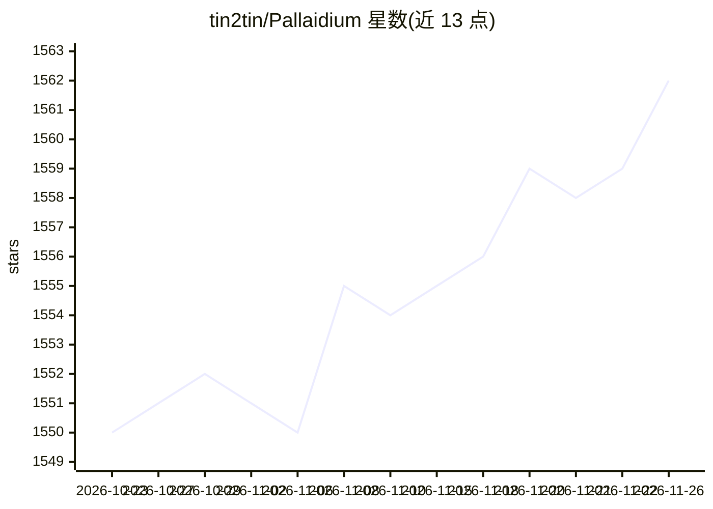

# tin2tin/Pallaidium

⭐ 1,562 · Python · GPL-3.0 · 推送 2026-11-25 · [GitHub](https://github.com/tin2tin/Pallaidium) · [官网](https://tin2tin.github.io/Pallaidium/) · 个人维护

**集成在 Blender 视频编辑器中的生成式 AI 影片工作室插件**

以 Blender 插件形式嵌入视频序列编辑器（VSE），提供从文本/图像/视频输入生成图像、视频、文本、音频、音乐与语音的功能矩阵，生成结果自动加入 VSE 时间线。工作流覆盖剧本转分镜、生图、动画、配音配乐及反向提取字幕重建剧本。默认本地运行模型（需 Nvidia CUDA 显卡），可选通过 OpenAI /v1 兼容协议接入远程后端（ComfyUI、fal.ai、LocalAI 等）。要求 Windows（Linux 有限支持）、Blender 5.2+、CUDA 12.8。

## 筛选速览

| 维度 | 判定 | 备注 |
|---|---|---|
| AI 角色 | `ai-native` | 本体是模型或模型工具 |
| 许可风险 | `dual` | GPL-3.0 |
| 部署形态 | `desktop` | 安装包/桌面程序 |
| 模型依赖 | — | README 未给出锁定关系 |
| 硬件要求 | `gpu-8g` | |
| 安装摩擦 | `medium` | 含编译或系统依赖之一 |
| 成熟度 | — | 结构信号不足 |

## 能力要点

- 文本/图像/视频到图像、视频、文本、音频、音乐、语音的生成矩阵
- 生成的媒体自动添加到 VSE 时间线，支持批量转换与渲染队列
- 可选远程后端：内置 ComfyUI、fal.ai、LocalAI 连接器及自定义连接器
- 支持 ControlNet、IP Adapter、多 LoRA、语音克隆等控制功能

## 适用场景

- 在 Blender 内用 AI 从剧本生成分镜图像与动画做前期原型
- 给视频片段生成配音、音乐或字幕
- 本地显存不足时将生成任务卸载到远程服务器

## 场景标签

`图像生成` `视频生成` `语音合成` · 领域:内容生成

## 证据(README 行号)

> L3:  A free generative AI movie studio integrated into the Blender Video Editor.
> L25: |Input|Image|Video|Text|Audio|Music|Speech|
> L52: * A CUDA-supported Nvidia card with at least 6-16 GB VRAM.

## 星数曲线

2026-10-23 1,550 → 2026-11-26 1,562（+12）

---
*卡片 v1 · prompt 1.4 · 生成 2026-11-23 · 置信度 high · 依据 README sha `367b82539c9d` · [字段定义](../../DATASET.md)*
