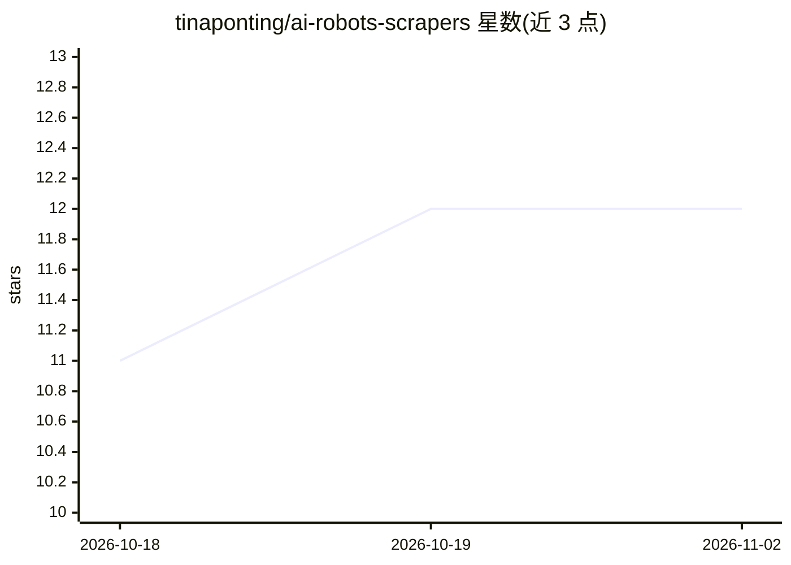

# tinaponting/ai-robots-scrapers

⭐ 12 · 推送 2026-11-01 · [GitHub](https://github.com/tinaponting/ai-robots-scrapers) · 个人维护

**阻挡 AI 爬虫的配置清单：robots.txt/htaccess/nginx 等多格式**

个人维护的 AI 爬虫封锁资源汇编：提供 robots.txt、htaccess、nginx、Caddy、HAProxy、Lighttpd、Hugo、Kirby 及 WordPress 插件等多种格式的封锁配置文件，含更新日志；另收录 TDMRep 协议、iocaine/Nepenthes/Anubis 等 AI 陷阱工具与外部封锁列表的链接。使用方式为下载 raw 文件上传到站点根目录或插件目录，README 以瑞典语、英语、德语、西班牙语重复说明。

## 筛选速览

| 维度 | 判定 | 备注 |
|---|---|---|
| AI 角色 | `ai-knowledge` | 知识聚合/清单类 |
| 许可风险 | `none` | — |
| 部署形态 | `None` |  |
| 模型依赖 | — | README 未给出锁定关系 |
| 硬件要求 | — | 无带数字的原话,不猜 |
| 安装摩擦 | `low` | 无编译、无系统依赖或容器化 |
| 成熟度 | — | 结构信号不足 |

## 能力要点

- 覆盖 robots.txt/htaccess/nginx/Caddy/HAProxy/Lighttpd 等多种服务器配置格式
- 提供 WordPress 插件与 Hugo/Kirby 配置文件
- 收录 AI 陷阱工具（iocaine、Nepenthes、Anubis 等）与 TDMRep 协议链接
- README 以瑞典语/英语/德语/西班牙语四种语言重复使用说明

## 适用场景

- 博客站长屏蔽 AI 爬虫抓取内容
- 为 nginx/Caddy/HAProxy 服务器添加 AI bot 封锁规则
- 查找 AI 陷阱与反爬工具的现成方案

## 场景标签

 · 领域:网站运维/内容防护

## 证据(README 行号)

> L1: Ai crapers - Ai bots - Ai robts.txt
> L54: ### PERRISHPRESS AI BLOCK: Download from heis site:
> L98: * Updated:260301: ROBOTS-HTACCESS LIST,Caddy, Myhaccess, Haproxy, nginx - Forgot a useragent!

## 星数曲线

2026-10-18 11 → 2026-11-02 12（+1）

---
*卡片 v1 · prompt 1.4 · 生成 2026-10-31 · 置信度 mid · 依据 README sha `647f9a20f7af` · [字段定义](../../DATASET.md)*
