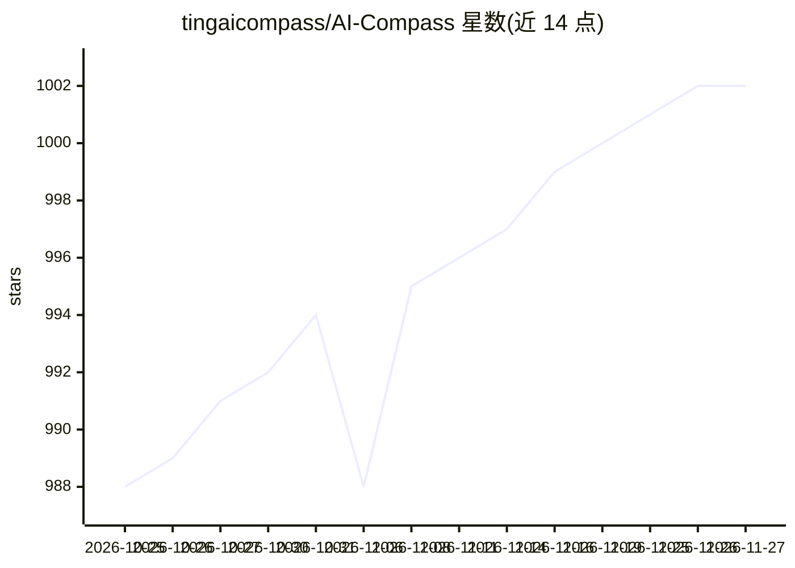

# tingaicompass/AI-Compass

⭐ 1,002 · Python · 推送 2026-11-24 · [GitHub](https://github.com/tingaicompass/AI-Compass) · [官网](https://blog.csdn.net/sinat_39620217?spm=1011.2124.3001.5343) · 个人维护 · 中文 README

**AI 技术资源策展知识库：为开发者提供 AI 全栈学习路径与每周速览**

以知识库形式组织的人工智能技术资源仓库，按九大模块系统化收录内容：博客文章、可运行实战代码、基础知识、训练/推理/评估技术框架、RAG 与 Agent 等应用架构、产品工具、学习资源、企业开源项目与社区平台，并持续发布每周 AI 前沿速览（已至 66 期）。提供将仓库安装为本地知识库 Skill 的脚本，供 Coding Agent 检索问答；用户可经 GitHub Issue 提交资源收录申请，声明不做付费排名。

## 筛选速览

| 维度 | 判定 | 备注 |
|---|---|---|
| AI 角色 | `ai-knowledge` | 知识聚合/清单类 |
| 许可风险 | `none` | — |
| 部署形态 | `None` |  |
| 模型依赖 | — | README 未给出锁定关系 |
| 硬件要求 | — | 无带数字的原话,不猜 |
| 安装摩擦 | `low` | 无编译、无系统依赖或容器化 |
| 成熟度 | — | 结构信号不足 |

## 能力要点

- 九大核心模块覆盖从基础理论到工程落地与求职面试的资源体系
- 每周前沿速览持续追踪模型、Agent 框架与多模态工具（66 期）
- 支持一键提示词由 Coding Agent 克隆并安装为本地知识库 Skill
- 开放资源收录申请，保留投稿台账

## 适用场景

- 系统规划 AI 领域的学习路径与技术选型
- 把仓库作为本地知识库，向 Coding Agent 提问 AI 技术、模型与项目
- 每周跟进大模型与智能体生态动态
- 准备 AI 岗位面试并查找项目实战资源

## 场景标签

 · 领域:AI 学习资源/知识聚合

## 证据(README 行号)

> L32: **AI-Compass**将为你和社区提供在AI技术海洋中航行的方向与指引。无论你是刚踏入AI领域的初学者，还是寻求技术突破的进阶开发者，都能在这里找到通往AI各大技术方向的清晰路径和实践指南。作为一个全面覆盖人工智能技术栈的综
> L34: 我们深度**整合了从基础理论到前沿应用的完整知识体系，涵盖大语言模型、多模态AI、机器学习、深度学习、计算机视觉、自然语言处理、推荐系统、强化学习等核心技术领域**，以及`RAG`、`Agent`、GraphRAG等前沿应用架构。
> L43: 如果本机还没有 AI-Compass，请先 clone https://github.com/tingaicompass/AI-Compass.git，然后按照 https://raw.githubusercontent.com/

## 星数曲线

2026-10-25 988 → 2026-11-27 1,002（+14）

---
*卡片 v1 · prompt 1.4 · 生成 2026-11-26 · 置信度 high · 依据 README sha `eaff70471f18` · [字段定义](../../DATASET.md)*
