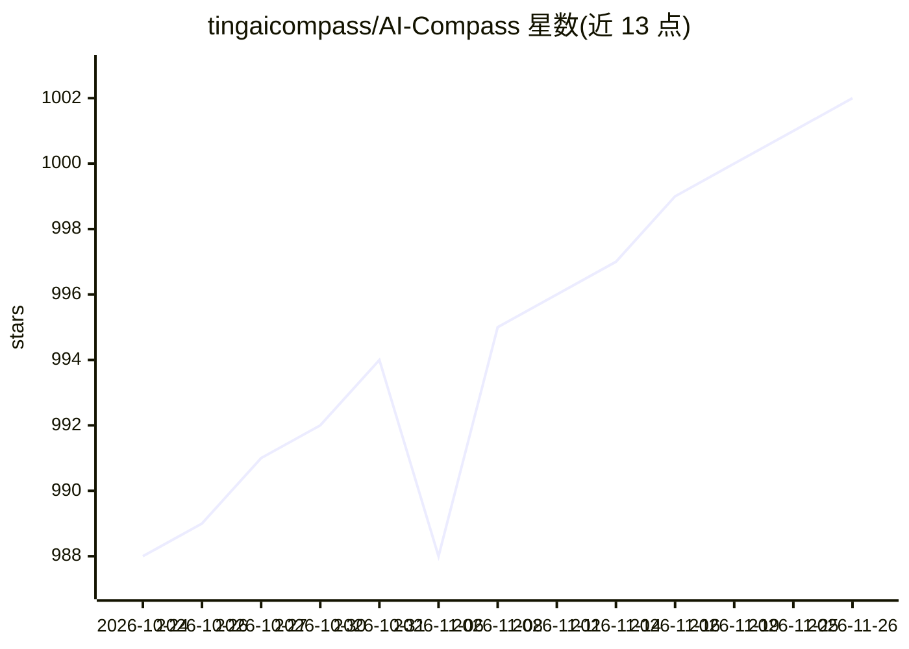

# tingaicompass/AI-Compass

⭐ 1,002 · Python · 推送 2026-11-24 · [GitHub](https://github.com/tingaicompass/AI-Compass) · [官网](https://blog.csdn.net/sinat_39620217?spm=1011.2124.3001.5343) · 个人维护 · 中文 README

**面向 AI 学习者的系统化资源导航与每周精选知识库**

以目录形式组织的 AI 学习资源仓库，按九大模块系统化收录资源：基础知识（导航工具、Prompt 工程、模型榜单）、技术框架（Embedding、训练、推理部署、RLHF）、应用实践（RAG、Agent、GraphRAG）、博客与可运行代码样例（含 Milvus RAG 工程）等，并持续发布每周 AI 前沿速览（截至第 65 期）。支持克隆到本地后交由 Coding Agent 安装为本地知识库 Skill，用于 AI 技术问答与项目拆解。资源收录通过 GitHub Issue 投稿，声明不做付费排名。

## 筛选速览

| 维度 | 判定 | 备注 |
|---|---|---|
| AI 角色 | `ai-knowledge` | 知识聚合/清单类 |
| 许可风险 | `none` | — |
| 部署形态 | `None` |  |
| 模型依赖 | — | README 未给出锁定关系 |
| 硬件要求 | — | 无带数字的原话,不猜 |
| 安装摩擦 | `low` | 无编译、无系统依赖或容器化 |
| 成熟度 | — | 结构信号不足 |

## 能力要点

- 九大核心模块组织 AI 学习资源，覆盖基础到工程落地
- 每周一期 AI 前沿速览周报（65 期，含收录与精选条数元数据）
- 支持作为 Coding Agent（Claude Code/Codex）本地知识库 Skill 安装
- 提供可运行的 RAG 工程实战代码与博客教程内容

## 适用场景

- 系统入门 AI 各技术方向并建立学习路径
- 做模型/工具选型与技术方案调研时检索资源
- 每周跟踪大模型与 Agent 生态的新发布
- 配合 Claude Code/Codex 对仓库内容做问答与项目拆解

## 场景标签

`教程课程` `精选清单` · 领域:学习与行业

## 证据(README 行号)

> L32: **AI-Compass**将为你和社区提供在AI技术海洋中航行的方向与指引。无论你是刚踏入AI领域的初学者，还是寻求技术突破的进阶开发者，都能在这里找到通往AI各大技术方向的清晰路径和实践指南。作为一个全面覆盖人工智能技术栈的综
> L54: ### 📋 核心模块架构：
> L45: 🤖 作为知识库使用：

## 星数曲线

2026-10-24 988 → 2026-11-26 1,002（+14）

---
*卡片 v1 · prompt 1.4 · 生成 2026-11-24 · 置信度 high · 依据 README sha `39a5da93e8a7` · [字段定义](../../DATASET.md)*
