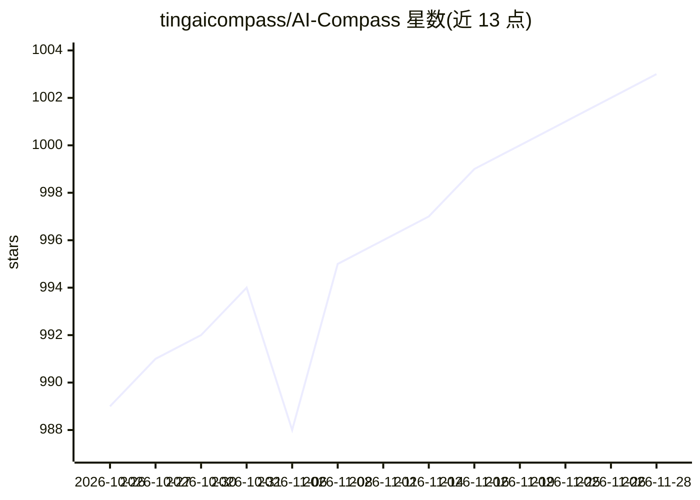

# tingaicompass/AI-Compass

⭐ 1,003 · Python · 推送 2026-11-27 · [GitHub](https://github.com/tingaicompass/AI-Compass) · [官网](https://blog.csdn.net/sinat_39620217?spm=1011.2124.3001.5343) · 个人维护 · 中文 README

**面向 AI 学习者与开发者的系统化资源导航与每周前沿速览清单**

一个覆盖 AI 技术栈的开源知识聚合仓库，按九大模块组织：博客、实战代码、基础知识、技术框架（Embedding/训练/推理部署/评估/RLHF）、应用实践（RAG/Agent/GraphRAG/MCP）、产品工具、学习资源、企业开源与社区平台。提供每周前沿速览（已至第 67 期，每期约 30 条收录），支持将仓库克隆为本地知识库，通过 Claude Code、Codex 等 Coding Agent 安装为 Skill 后按需问答。资源收录通过 GitHub Issue 投稿，声明不做付费排名。

## 筛选速览

| 维度 | 判定 | 备注 |
|---|---|---|
| AI 角色 | `ai-knowledge` | 知识聚合/清单类 |
| 许可风险 | `none` | — |
| 部署形态 | `None` |  |
| 模型依赖 | — | README 未给出锁定关系 |
| 硬件要求 | — | 无带数字的原话,不猜 |
| 安装摩擦 | `low` | 无编译、无系统依赖或容器化 |
| 成熟度 | — | 结构信号不足 |

## 能力要点

- 九大核心模块覆盖从基础理论到工程落地的资源组织
- 每周前沿速览已更新 67 期，每期含收录数与主题分类
- 可作为本地知识库安装为 Codex/Claude Code 的 Skill 供 Agent 问答
- 通过 GitHub Issue 开放资源收录申请并维护投稿台账

## 适用场景

- 按学习路径系统性了解大模型、RAG、Agent 等方向
- 让 Coding Agent 基于仓库内容做技术问答与项目拆解
- 追踪每周 AI 工具与模型发布动态
- 查找企业级开源资源与面试准备材料

## 场景标签

`精选清单` `教程课程` `科研工具` · 领域:学习与行业

## 证据(README 行号)

> L32: **AI-Compass**将为你和社区提供在AI技术海洋中航行的方向与指引。无论你是刚踏入AI领域的初学者，还是寻求技术突破的进阶开发者，都能在这里找到通往AI各大技术方向的清晰路径和实践指南。作为一个全面覆盖人工智能技术栈的综
> L34: 我们深度**整合了从基础理论到前沿应用的完整知识体系，涵盖大语言模型、多模态AI、机器学习、深度学习、计算机视觉、自然语言处理、推荐系统、强化学习等核心技术领域**，以及`RAG`、`Agent`、GraphRAG等前沿应用架构。
> L52: **AI-Compass** 致力于构建最全面、最实用、最前沿的AI技术学习和实践生态，通过九大核心模块的系统化组织，为不同层次的学习者和开发者提供从入门到精通的完整学习路径。

## 星数曲线

2026-10-26 989 → 2026-11-28 1,003（+14）

---
*卡片 v1 · prompt 1.4 · 生成 2026-11-28 · 置信度 high · 依据 README sha `75dfcbc46ca6` · [字段定义](../../DATASET.md)*
