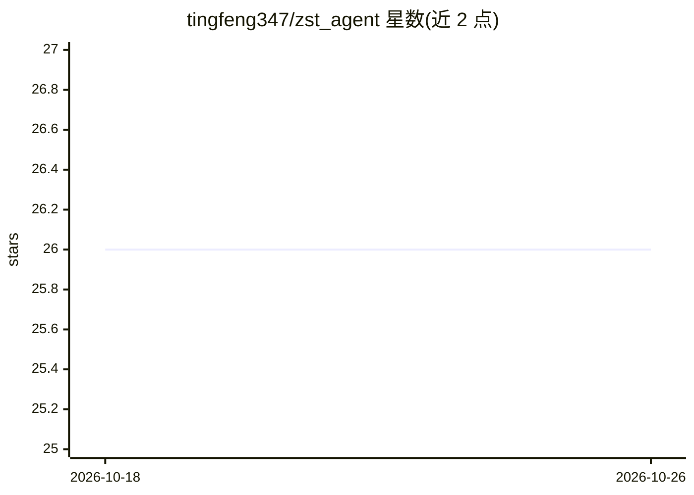

# tingfeng347/zst_agent

⭐ 26 · Vue · 推送 2026-07-04 · [GitHub](https://github.com/tingfeng347/zst_agent) · 个人维护 · 中文 README

**扫地机器人领域智能客服系统：RAG 问答 + ReAct Agent**

基于 FastAPI 后端与 Vue 3 前端的前后端分离智能客服系统，面向智能家居（扫地机器人）咨询场景。提供 RAG 三级混合检索（Chroma 向量检索 + Jieba 标题关键词匹配 + BGE-Reranker 重排序）、ReAct Agent 工具调用（支持 MCP 协议接入外部工具）、SSE 流式对话、多会话管理与 JWT 双令牌认证。模型通过阿里云百炼 OpenAI 兼容接口接入（默认 qwen3-max 与 text-embedding-v4），需自备 DashScope API Key 与 MySQL 数据库；知识库支持 PDF/TXT/CSV 解析入向量库。源码部署，后端 uv 安装依赖，前端 npm 构建。

## 筛选速览

| 维度 | 判定 | 备注 |
|---|---|---|
| AI 角色 | `ai-native` | 本体是模型或模型工具 |
| 许可风险 | `none` | — |
| 部署形态 | `library` | 以包/库形式分发 |
| 模型依赖 | — | README 未给出锁定关系 |
| 硬件要求 | — | 无带数字的原话,不猜 |
| 安装摩擦 | `low` | 无编译、无系统依赖或容器化 |
| 成熟度 | — | 结构信号不足 |

## 能力要点

- 三级混合检索：向量检索 + 标题关键词匹配 + BGE-Reranker 重排序
- ReAct Agent 思考-行动-观察循环，支持 MCP 协议接入外部工具
- SSE Token 级流式对话与 JWT + Refresh Token 双令牌认证
- 知识库支持 PDF/TXT/CSV 文档解析与向量化存储

## 适用场景

- 为扫地机器人产品搭建知识库问答客服
- 通过 Agent 工具调用处理需检索/联网的用户咨询
- 企业内部基于自有文档搭建智能问答系统

## 场景标签

 · 领域:企业客服/LLM 应用

## 证据(README 行号)

> L14: - **智能问答**：基于 RAG 检索增强生成，从知识库精准检索并生成专业回答
> L15: - **Agent 工具调用**：集成 ReAct Agent，支持自主工具选择、多轮推理和场景切换
> L10: 针对智能家居场景下用户咨询需求多样化、知识库检索精度不足的问题，设计实现的扫地机器人领域智能客服系统。

## 星数曲线

2026-10-18 26 → 2026-10-26 26（+0）

---
*卡片 v1 · prompt 1.4 · 生成 2026-10-26 · 置信度 high · 依据 README sha `b335cf88313a` · [字段定义](../../DATASET.md)*
