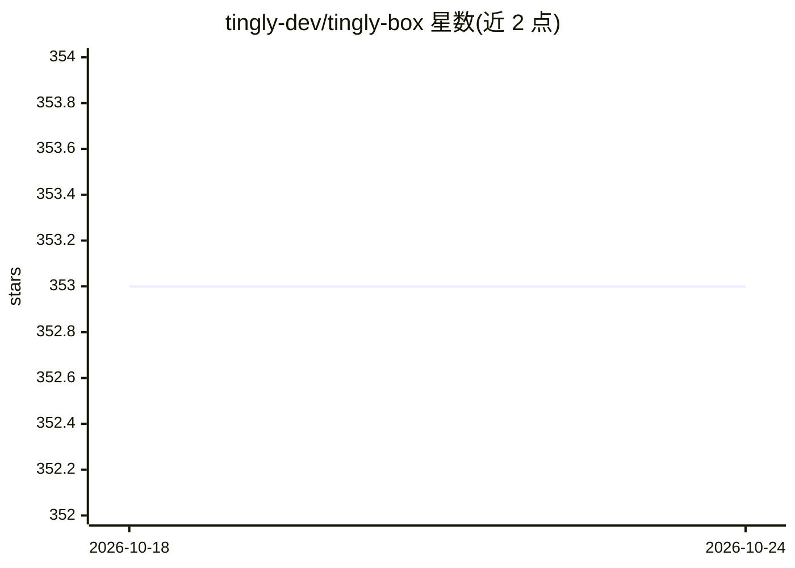

# tingly-dev/tingly-box

⭐ 356 · Go · MPL-2.0 · 推送 2026-10-24 · [GitHub](https://github.com/tingly-dev/tingly-box) · [官网](https://tingly-dev.github.io/tingly-box/) · 组织维护 · 中文 README

**自托管 LLM 网关：任意 Agent 接任意模型，含团队管理与远程控制**

Go 编写的统一 AI 网关，通过单一端点将 Claude Code、OpenCode、Codex、Xcode 等 agent 客户端桥接到各类模型供应商，支持 Anthropic/OpenAI 协议双向转换、API key 与 OAuth、按成本/速度的智能路由。面向个人与团队：提供共享端点、成员专属 key、按用户用量统计；另含 Guardrails、MCP 网关、用量分析、图像生成 API，以及经 Telegram/钉钉/飞书/微信等 IM 平台远程操控 agent。npm/npx/Docker 方式安装，自带 Web 管理界面。

## 筛选速览

| 维度 | 判定 | 备注 |
|---|---|---|
| AI 角色 | `ai-ecosystem` | LLM/agent 周边工具 |
| 许可风险 | `permissive` | MPL-2.0 |
| 部署形态 | `self-host` | docker 或自建部署 |
| 模型依赖 | local-ok | 支持本地模型 |
| 硬件要求 | — | 无带数字的原话,不猜 |
| 安装摩擦 | `low` | 无编译、无系统依赖或容器化 |
| 成熟度 | — | 结构信号不足 |

## 能力要点

- 任意 Agent ⇄ 任意模型的统一端点，协议双向转换
- DeepSeek 专项兼容：视觉代理、1M 上下文、缓存命中优化
- 团队成员专属 key 与按用户用量追踪
- 经 Telegram/钉钉/飞书/微信/企业微信远程控制 agent

## 适用场景

- 让 Claude Code 等 agent 客户端接入不同模型供应商
- 团队共享一个模型端点并按成员追踪用量
- 通过手机 IM 远程执行与监控 AI agent 任务

## 场景标签

`模型网关` · 领域:Agent 开发

## 证据(README 行号)

> L15: Tingly Box **connects any agent to any model** — for you and your whole team, with built-in power-ups.
> L20:  * Unified endpoint for AI — bridge any providers, with protocols translated both ways
> L100:  Agent Integration - Claude Code / Claude Desktop / OpenCode / Codex / Xcode / VSCode / OpenClaw

## 星数曲线

2026-10-18 353 → 2026-10-24 353（+0）

---
*卡片 v1 · prompt 1.4 · 生成 2026-10-22 · 置信度 high · 依据 README sha `a00c0778ff3d` · [字段定义](../../DATASET.md)*
