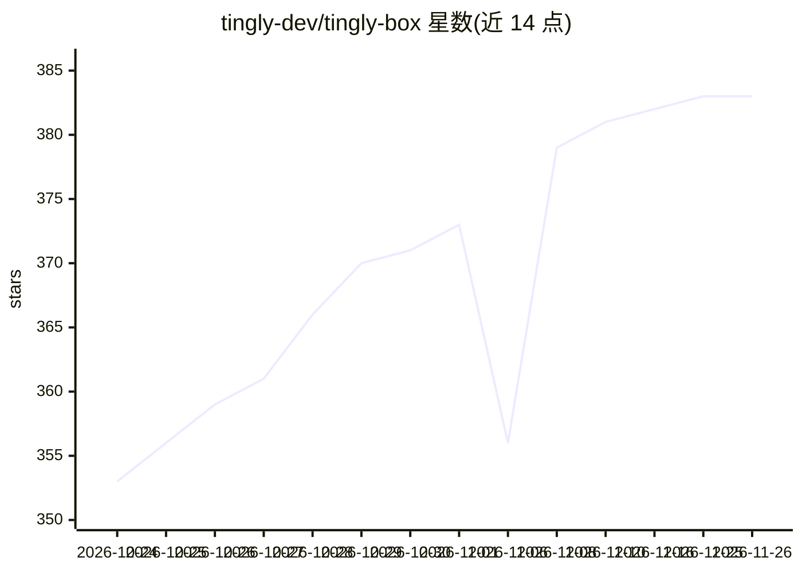

# tingly-dev/tingly-box

⭐ 383 · Go · MPL-2.0 · 推送 2026-11-25 · [GitHub](https://github.com/tingly-dev/tingly-box) · [官网](https://tingly-dev.github.io/tingly-box/) · 组织维护 · 中文 README

**为个人与团队统一接入任意 Agent 与任意模型的 AI 网关**

用 Go 与 Node 开发的自托管 LLM 网关：将多个上游 provider（官方 API、OAuth 账号、自托管推理服务器）桥接为统一端点，并在 Anthropic/OpenAI 协议间双向转换；支持按成本、速度或自定义策略路由，提供团队共享端点、成员独立密钥与用量统计。附带 Guardrails、MCP Gateway、图像生成 API 与通过 Telegram/钉钉/飞书/微信等 IM 远程控制 Agent 的功能，提供 Web 管理界面，运行开销 <1ms。

## 筛选速览

| 维度 | 判定 | 备注 |
|---|---|---|
| AI 角色 | `ai-ecosystem` | LLM/agent 周边工具 |
| 许可风险 | `permissive` | MPL-2.0 |
| 部署形态 | `self-host` | docker 或自建部署 |
| 模型依赖 | local-ok | 支持本地模型 |
| 硬件要求 | — | 无带数字的原话,不猜 |
| 安装摩擦 | `low` | 无编译、无系统依赖或容器化 |
| 成熟度 | — | 结构信号不足 |

## 能力要点

- 统一端点桥接任意 Agent 与任意模型，协议双向转换
- 支持 API key 与 OAuth 两种接入方式复用现有配额
- 团队共享端点：按成员分发密钥并统计用量
- 通过 Telegram/钉钉/飞书/微信等 IM 远程控制 Agent

## 适用场景

- 为 Claude Code/OpenCode/Codex 等客户端一键配置统一模型端点
- 团队集中管理模型规则并按成员追踪 AI 用量
- 把自托管的 vLLM/Ollama 推理服务器接入统一网关
- 通过手机 IM 远程下达任务给运行中的 Agent

## 场景标签

`模型网关` · 领域:Agent 开发

## 证据(README 行号)

> L15: Tingly Box **connects any agent to any model** — for you and your whole team, with built-in power-ups.
> L20:  * Unified endpoint for AI — bridge any providers, with protocols translated both ways

## 星数曲线

2026-10-24 353 → 2026-11-26 383（+30）

---
*卡片 v1 · prompt 1.4 · 生成 2026-11-25 · 置信度 high · 依据 README sha `4dea001e8c46` · [字段定义](../../DATASET.md)*
