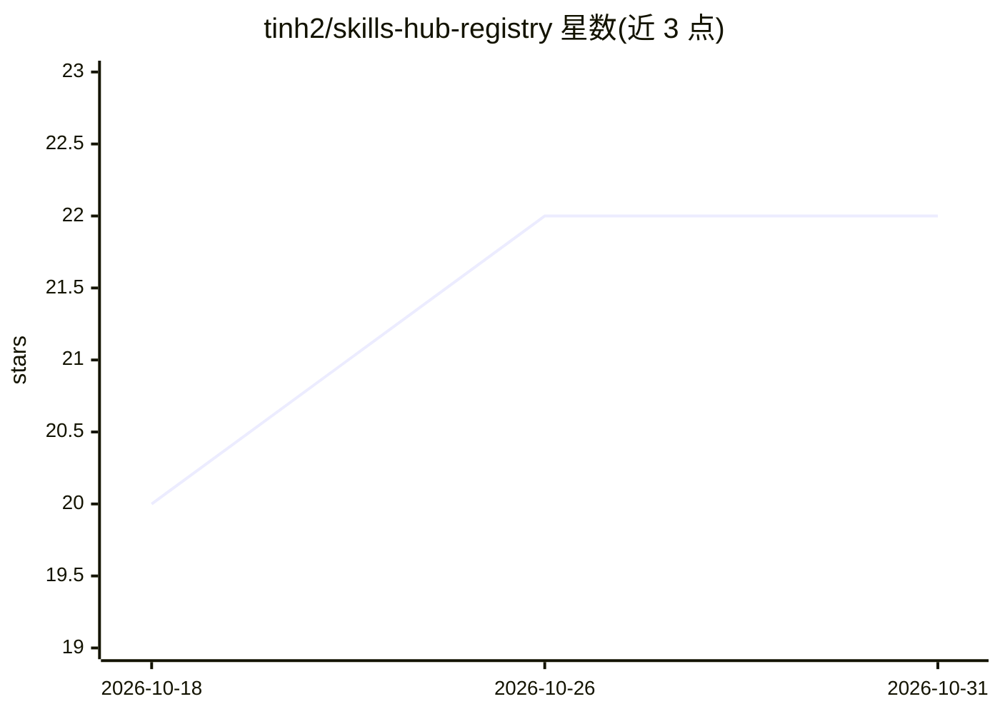

# tinh2/skills-hub-registry

⭐ 22 · Python · 推送 2026-10-28 · [GitHub](https://github.com/tinh2/skills-hub-registry) · [官网](https://skills-hub.ai) · 组织维护

**面向 AI 编程工具的社区技能注册表：430 个 SKILL.md 技能分类收录**

skills-hub.ai 的官方技能集合仓库：收录 430 个以 SKILL.md 格式交付的 AI 编程技能，按 15 个类别组织，覆盖软件开发全生命周期、40 个行业垂直领域及游戏与移动开发；每日同步到 skills-hub.ai。多数类别采用主技能+子技能的编排模式，由主技能扫描缺口并路由到专门子技能；技能兼容 Claude Code、Cursor、Codex CLI 等 MCP 兼容工具，通过一条命令安装。

## 筛选速览

| 维度 | 判定 | 备注 |
|---|---|---|
| AI 角色 | `ai-knowledge` | 知识聚合/清单类 |
| 许可风险 | `none` | — |
| 部署形态 | `self-host` | docker 或自建部署 |
| 模型依赖 | — | README 未给出锁定关系 |
| 硬件要求 | — | 无带数字的原话,不猜 |
| 安装摩擦 | `low` | 无编译、无系统依赖或容器化 |
| 成熟度 | — | 结构信号不足 |

## 能力要点

- 430 个技能按 15 个类别组织，每日同步到 skills-hub.ai
- 主技能+子技能编排模式（如 /integrate、/devops、/secure 路由到专门子技能）
- 技能版本均为 v2.0.0+，内置自愈校验与自演化遥测
- 跨 Claude Code、Cursor、Codex CLI、Windsurf、Copilot 等 MCP 兼容工具安装

## 适用场景

- 为 Claude Code 等 AI 编程工具查找和安装现成技能
- 按类别浏览覆盖开发全生命周期的技能目录
- 游戏与移动应用开发场景寻找对应脚手架技能

## 场景标签

`精选清单` `提示工程` · 领域:Agent 开发

## 证据(README 行号)

> L3: The official skill collection for skills-hub.ai -- a marketplace for Claude Code skills.
> L5: 430 production-tested skills organized into 15 categories covering the complete software development lifecycle, 40 i

## 星数曲线

2026-10-18 20 → 2026-10-31 22（+2）

---
*卡片 v1 · prompt 1.4 · 生成 2026-10-27 · 置信度 mid · 依据 README sha `2409e0aec3e6` · [字段定义](../../DATASET.md)*
