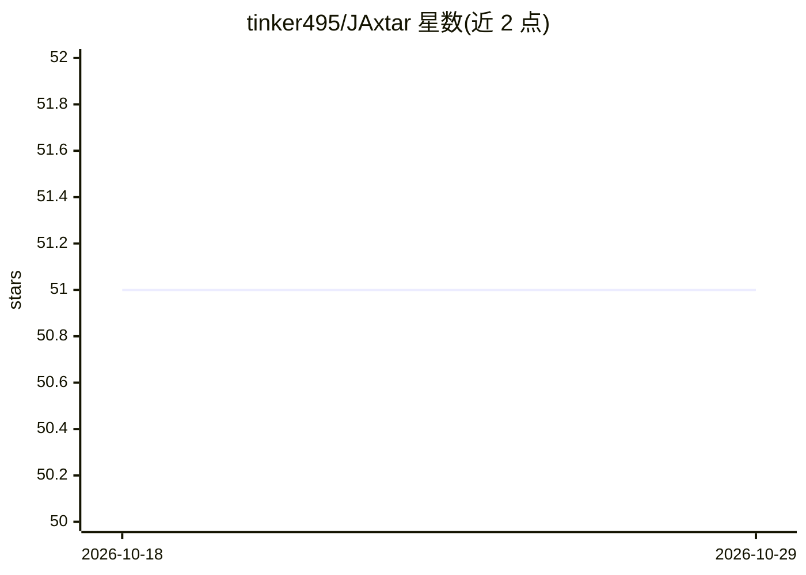

# tinker495/JAxtar

⭐ 51 · Python · MIT · 推送 2026-10-24 · [GitHub](https://github.com/tinker495/JAxtar) · 个人维护

**给科研者的纯 JAX GPU 批量并行 A*/Q* 启发式搜索求解器**

面向神经启发式搜索研究的纯 JAX 实现，提供 A*、双向 A*、迭代加深 A*、Beam Search 及结合学习型 Q 值的 Q*、Bi-Q*、Q-Beam 等 10 种图搜索算法，全部 JIT 编译并批量化以在 GPU 上运行，消除 CPU-GPU 通信开销。含 JAX 原生哈希表与优先队列（Xtructure 库）、独立的谜题环境库 PuXle（魔方、推箱子、迷宫、TSP 等），支持神经网络启发式与世界模型潜在空间搜索。通过 uv 从 GitHub 安装，控制台命令仅在 checkout 内可用。ID-Q* 标注为实验性。

## 筛选速览

| 维度 | 判定 | 备注 |
|---|---|---|
| AI 角色 | `ai-native` | 本体是模型或模型工具 |
| 许可风险 | `permissive` | MIT |
| 部署形态 | `library` | 以包/库形式分发 |
| 模型依赖 | — | README 未给出锁定关系 |
| 硬件要求 | — | 无带数字的原话,不猜 |
| 安装摩擦 | `medium` | 含编译或系统依赖之一 |
| 成熟度 | `idea` | |

## 能力要点

- 10 种批量化、JIT 编译的 A*/Q* 图搜索算法变体
- JAX 原生哈希表与优先队列支撑无限状态空间
- 支持神经网络启发式与 PuXle 世界模型潜在空间搜索
- 谜题无关（puzzle-agnostic）实现，覆盖魔方/推箱子/TSP 等

## 适用场景

- 用神经网络启发式在 GPU 上批量求解魔方、推箱子等谜题
- 研究可微分/JIT 编译的 A* 与 Q* 图搜索算法
- 在学习到的世界模型潜在空间中执行启发式搜索

## 场景标签

`科研工具` · 领域:学习与行业

## 证据(README 行号)

> L5: JA xtar is a project with a JAX-native implementation of parallelizable a A\* & Q\* solver for neural heuristic sear
> L15: - **Q\***: Q* Search (A* with learned Q-values)
> L54: - Network heuristics and Q-functions designed for JIT-compilable integration with A\* & Q\* algorithm

## 星数曲线

2026-10-18 51 → 2026-10-29 51（+0）

---
*卡片 v1 · prompt 1.4 · 生成 2026-10-24 · 置信度 mid · 依据 README sha `c2e4d9835a86` · [字段定义](../../DATASET.md)*
