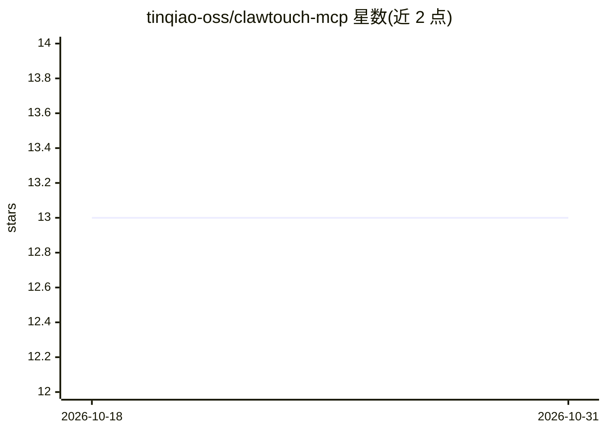

# tinqiao-oss/clawtouch-mcp

⭐ 13 · Python · MIT · 推送 2026-10-15 · [GitHub](https://github.com/tinqiao-oss/clawtouch-mcp) · [官网](https://clawtouch.cn) · 组织维护 · 中文 README

**把 USB HID 键鼠开发板暴露为 MCP 工具的 Python 服务器**

一个通过 stdio JSON-RPC 说 Model Context Protocol 的独立 Python 进程，向任意 MCP 兼容客户端（Claude Desktop、Cursor、Cline 等）暴露 16 个工具（hid.click/type/scroll、按键组合、可选 hid.screenshot 等）。底层经 USB-CDC 串口与运行 ClawTouch 固件的 Raspberry Pi Pico 2 通信，由开发板向目标系统发出真实 USB HID 报文，目标机输入侧无需驱动或代理进程。内置坐标钳制、4096 字符输入上限、限速等防护，hid.type 仅支持 ASCII 文本，截图默认关闭。需要配套 Pico 2 硬件。

## 筛选速览

| 维度 | 判定 | 备注 |
|---|---|---|
| AI 角色 | `ai-ecosystem` | LLM/agent 周边工具 |
| 许可风险 | `permissive` | MIT |
| 部署形态 | `library` | 以包/库形式分发 |
| 模型依赖 | — | README 未给出锁定关系 |
| 硬件要求 | — | 无带数字的原话,不猜 |
| 安装摩擦 | `low` | 无编译、无系统依赖或容器化 |
| 成熟度 | — | 结构信号不足 |

## 能力要点

- 把 MCP 工具调用转发为真实 USB HID 报文（经 Raspberry Pi Pico 2）
- 16 个工具：14 个 HID + 2 个设备工具，截图需显式 --allow-screenshot 开启
- 目标机输入侧无需驱动或输入代理，Pico 被识别为标准 USB HID 设备
- 运行时安全限制：坐标钳制、4096 字符上限、限速（默认 20 ops/秒）

## 适用场景

- 让 AI agent 操作无法安装输入驱动的自助终端或受限机器
- 验证软件对外部真实 HID 输入的兼容性
- 构建 agent 驱动测试机的自动化测试台架
- 辅助用户通过 agent 以 HID 命令操作自己的电脑

## 场景标签

`GUI 自动化` · 领域:效率与自动化

## 证据(README 行号)

> L22: A standalone Python process that speaks **Model Context Protocol** (MCP) over
> L24: `hid.scroll`, key combos, `hid.screenshot` — to whatever AI agent you already
> L27: turnkey ClawTouch box) and translates each tool call into a real USB HID report.

## 星数曲线

2026-10-18 13 → 2026-10-31 13（+0）

---
*卡片 v1 · prompt 1.4 · 生成 2026-10-31 · 置信度 high · 依据 README sha `434d26131565` · [字段定义](../../DATASET.md)*
