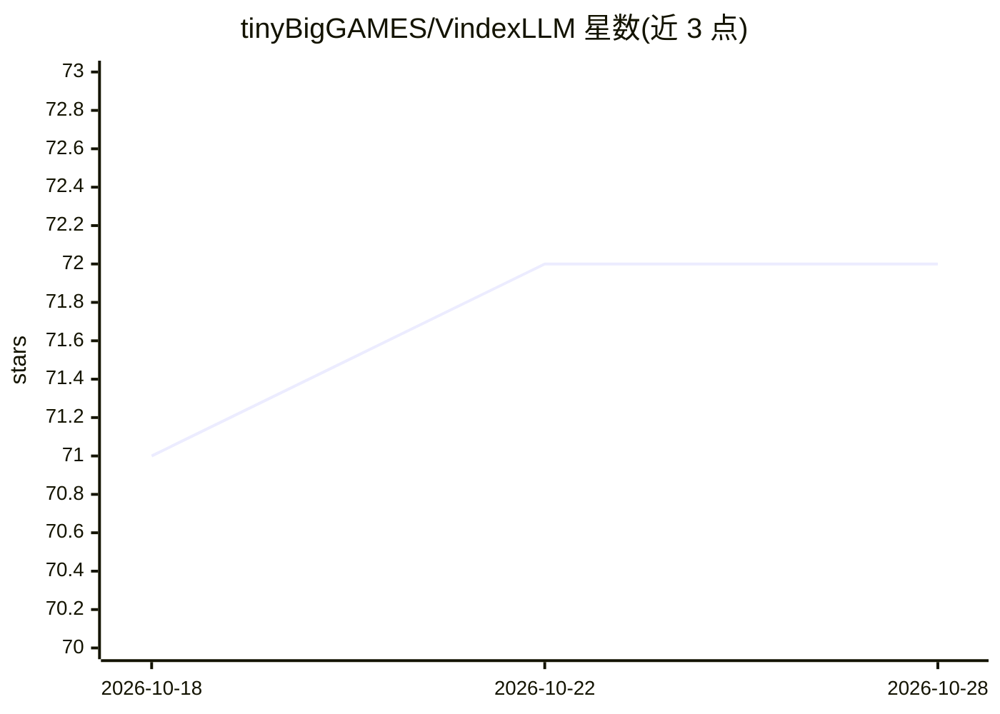

# tinyBigGAMES/VindexLLM

⭐ 72 · Pascal · NOASSERTION · 推送 2026-04-21 · [GitHub](https://github.com/tinyBigGAMES/VindexLLM) · 组织维护

**纯 Delphi 编写的 GPU LLM 推理引擎，Vulkan 运行 GGUF 模型**

面向 Delphi 开发者的 LLM 推理引擎：用 Vulkan 计算着色器在 GPU 上完成 Gemma 3 4B 的完整 transformer 前向推理，加载 GGUF 模型并流式生成文本，不依赖 Python、CUDA 或外部运行时，唯一运行时依赖为随 GPU 驱动附带的 vulkan-1.dll。附带会话管理、SQLite 持久记忆与基于 EmbeddingGemma 的 RAG 检索。当前仅支持 Gemma 3 4B 架构，需用 Delphi 12+ 自行编译，支持 F16/Q8_0/Q4_0 权重与自研 TQ3 KV 缓存 3 比特量化。

## 筛选速览

| 维度 | 判定 | 备注 |
|---|---|---|
| AI 角色 | `ai-ecosystem` | LLM/agent 周边工具 |
| 许可风险 | `none` | NOASSERTION |
| 部署形态 | `desktop` | 安装包/桌面程序 |
| 模型依赖 | — | README 未给出锁定关系 |
| 硬件要求 | `gpu-8g` | |
| 安装摩擦 | `medium` | 含编译或系统依赖之一 |
| 成熟度 | `idea` | |

## 能力要点

- 37 个 GLSL 450 计算着色器编译为 SPIR-V 并嵌入二进制，GPU 上运行全部推理
- 支持 F16/Q8_0/Q4_0 GGUF 权重，TQ3 KV 缓存压缩约 9×
- 多轮控制台聊天 + SQLite 持久记忆 + EmbeddingGemma 300M RAG 检索
- 纯 Delphi BPE 分词器，温度/top-K/top-P/min-P 采样与确定性播种

## 适用场景

- 在 Windows Delphi 应用中嵌入本地 LLM 推理，无需 Python/CUDA 环境
- 构建带持久记忆与 RAG 的本地多轮对话程序
- 在 4-6GB VRAM 消费级 GPU 上运行 Gemma 3 4B 全栈（推理+嵌入+RAG）

## 场景标签

`推理引擎` `RAG` · 领域:知识与检索

## 证据(README 行号)

> L7: **VindexLLM** is a GPU-accelerated LLM inference engine written entirely in Delphi, using Vulkan compute shaders for
> L59: - Full Gemma 3 4B forward pass (34 layers, all on GPU, no CPU fallbacks)

## 星数曲线

2026-10-18 71 → 2026-10-28 72（+1）

---
*卡片 v1 · prompt 1.4 · 生成 2026-10-24 · 置信度 high · 依据 README sha `5da44c0d44f1` · [字段定义](../../DATASET.md)*
