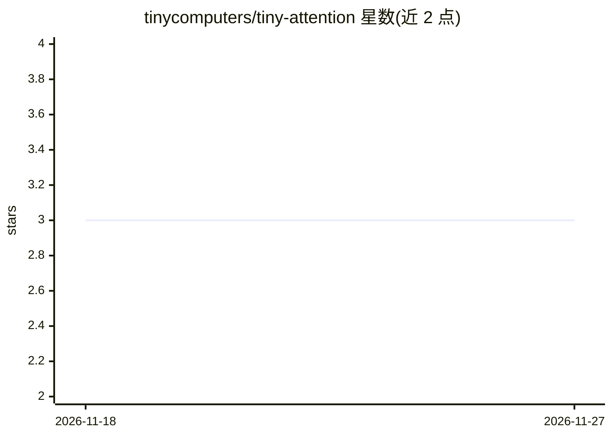

# tinycomputers/tiny-attention

⭐ 3 · TypeScript · MIT · 推送 2026-11-08 · [GitHub](https://github.com/tinycomputers/tiny-attention) · [官网](https://tiny-attention.vercel.app) · 个人维护

**浏览器可视化运行的 SystemVerilog FlashAttention 硬件引擎**

以 SystemVerilog 实现的 FlashAttention 引擎：包含两个 4×4 脉动阵列、在线 softmax（exp2 与倒数单元）与因果掩码，端到端 INT8 定点。RTL 通过 Verilator 编译为 C++ 再经 Emscripten 编译为 84KB WebAssembly 模块，在 Astro+React 可视化器中逐步执行并从调试端口读取数值；同一 RTL 可综合到 ECP5 FPGA（LFE5U-85F，UART 接口，时序尚未收敛、未上板验证）。用 cocotb 与 Python golden 模型逐位比对验证，含 1000 种子数值研究，文档覆盖 attention、定点格式与验证结果。

## 筛选速览

| 维度 | 判定 | 备注 |
|---|---|---|
| AI 角色 | `ai-native` | 本体是模型或模型工具 |
| 许可风险 | `permissive` | MIT |
| 部署形态 | `library` | 以包/库形式分发 |
| 模型依赖 | — | README 未给出锁定关系 |
| 硬件要求 | — | 无带数字的原话,不猜 |
| 安装摩擦 | `low` | 无编译、无系统依赖或容器化 |
| 成熟度 | — | 结构信号不足 |

## 能力要点

- 真实 FlashAttention 数据通路的 RTL 实现（FLASH 与 NAIVE 两种调度共用同一数据通路）
- cocotb 端到端测试与 golden 模型逐位一致，覆盖 N=4..32、多种子与随机 HBM 延迟
- RTL 经 Verilator+Emscripten 编译为 WebAssembly，在浏览器中逐步执行并可视化
- 可综合到 ECP5（LFE5U-85F，ULX3S），报告无推断锁存器

## 适用场景

- 在浏览器中逐步观察 FlashAttention 的分块调度、在线 softmax 与 HBM 流量
- 学习 attention、定点量化与硬件验证的教学演示
- 作为可综合 attention 引擎的 FPGA 实验起点

## 场景标签

`教程课程` · 领域:学习与行业

## 证据(README 行号)

> L5:  A synthesizable FlashAttention engine, verified bit-exact against a golden model,
> L61: - **A real FlashAttention datapath in RTL.** Two 4 × 4 systolic arrays (`S = Q·Kᵀ` and `P·V`), scale and causal mas
> L8:  The tiled online-softmax schedule from the FlashAttention paper, as real RTL: the N × N score matrix never leaves t

## 星数曲线

2026-11-18 3 → 2026-11-27 3（+0）

---
*卡片 v1 · prompt 1.4 · 生成 2026-11-21 · 置信度 high · 依据 README sha `83d53a0106bc` · [字段定义](../../DATASET.md)*
