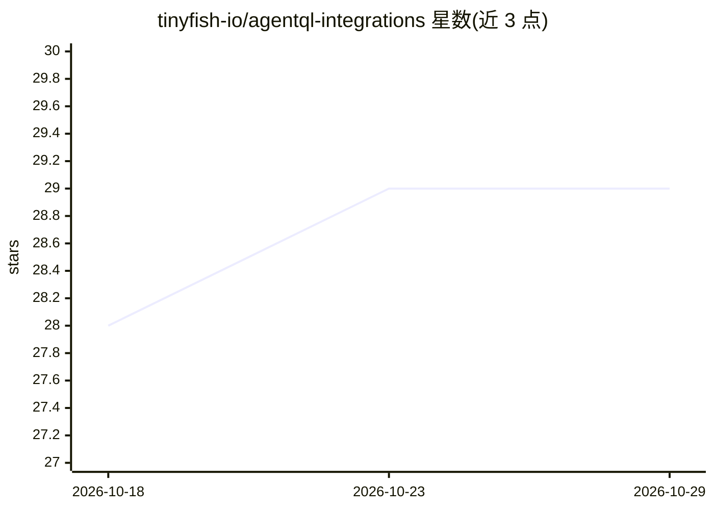

# tinyfish-io/agentql-integrations

⭐ 29 · Jupyter Notebook · MIT · 推送 2026-10-22 · [GitHub](https://github.com/tinyfish-io/agentql-integrations) · [官网](https://docs.agentql.com/integrations) · 组织维护

**AgentQL 与自动化工作流和 AI agent 框架的集成集合**

AgentQL 官方维护的集成仓库：AgentQL 通过 AgentQL 查询或自然语言提示从网页提取结构化数据，并借助 Playwright 与网页交互，面向自动化流程和 AI agent 场景。本仓库收集其与各类工作流自动化工具和 AI agent 框架的集成，并开放贡献（欢迎将 AgentQL 接入新生态），整体以 MIT 许可发布。README 未列出具体集成的安装与运行命令。

## 筛选速览

| 维度 | 判定 | 备注 |
|---|---|---|
| AI 角色 | `ai-ecosystem` | LLM/agent 周边工具 |
| 许可风险 | `permissive` | MIT |
| 部署形态 | `None` |  |
| 模型依赖 | — | README 未给出锁定关系 |
| 硬件要求 | — | 无带数字的原话,不猜 |
| 安装摩擦 | `low` | 无编译、无系统依赖或容器化 |
| 成熟度 | — | 结构信号不足 |

## 能力要点

- 以 AgentQL 查询或自然语言提示从网页提取结构化数据
- 通过 Playwright 与网页交互（查找元素、提交表单等）
- 官方开放集成贡献指南，面向自动化与 AI agent 生态

## 适用场景

- 自动化流程中在不知晓选择器的情况下定位页面元素
- 抓取职位网站等页面的结构化数据
- 让 AI agent 读取网页数据并执行表单等交互操作

## 场景标签

`浏览器自动化` `网页抓取` `工作流自动化` · 领域:效率与自动化

## 证据(README 行号)

> L3: AgentQL provides structured data extraction from web pages using an AgentQL query or a Natural Language prompt and c
> L15: Want to contribute to these integrations? We love adding AgentQL to new ecosystems! Check out our contribution guid

## 星数曲线

2026-10-18 28 → 2026-10-29 29（+1）

---
*卡片 v1 · prompt 1.4 · 生成 2026-10-26 · 置信度 low · 依据 README sha `64d43c24365c` · [字段定义](../../DATASET.md)*
