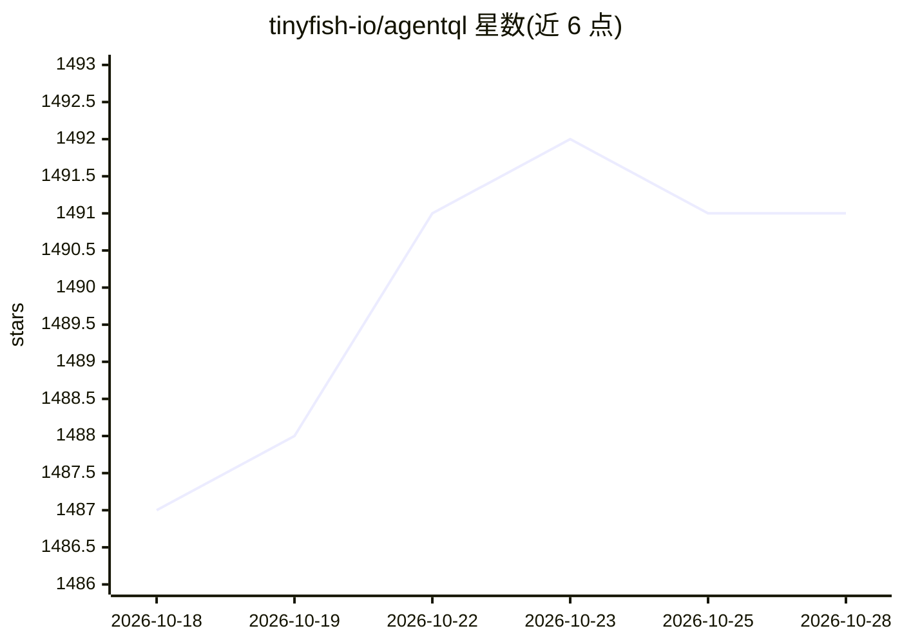

# tinyfish-io/agentql

⭐ 1,491 · Python · MIT · 推送 2026-10-26 · [GitHub](https://github.com/tinyfish-io/agentql) · [官网](https://agentql.com) · 组织维护

**用自然语言查询网页元素与数据的 AI 网页交互工具套件**

AgentQL 提供一套连接 LLM/AI agent 与网页的工具：基于 AI 的查询语言（自然语言选择器定位页面元素与数据）、Python/JavaScript SDK、REST API、浏览器调试扩展与 Playground。支持定义结构化输出与查询内数据变换，可作用于登录后与动态生成页面，选择器随 UI 变化自愈，并可跨结构相似的站点复用。与 Playwright 集成实现自动化，并提供 LangChain、Zapier 集成与 MCP server。README 仅列出示例与文档链接，安装命令见外部文档。

## 筛选速览

| 维度 | 判定 | 备注 |
|---|---|---|
| AI 角色 | `ai-ecosystem` | LLM/agent 周边工具 |
| 许可风险 | `permissive` | MIT |
| 部署形态 | `None` |  |
| 模型依赖 | — | README 未给出锁定关系 |
| 硬件要求 | — | 无带数字的原话,不猜 |
| 安装摩擦 | `low` | 无编译、无系统依赖或容器化 |
| 成熟度 | — | 结构信号不足 |

## 能力要点

- 自然语言查询定位任意页面元素与数据，选择器随 UI 变化自愈
- 查询内定义结构化输出与数据变换
- Python/JavaScript SDK、REST API、浏览器调试扩展、Playground 多形态交付
- 与 Playwright 集成，另提供 LangChain/Zapier 集成与 MCP server

## 适用场景

- 用自然语言查询在动态网页上提取结构化数据
- 为 AI agent 提供访问登录后网页内容的自动化通道
- 编写跨结构相似站点复用的抓取与自动化脚本

## 场景标签

`网页抓取` `浏览器自动化` · 领域:效率与自动化

## 证据(README 行号)

> L7:  AgentQL connects LLMs and AI agents to the entire web
> L19: AgentQL is a suite of tools for extracting data and automating workflows on live web sites featuring an AI-powered 
> L38: - **Integrations** with agent frameworks and automation tools like Langchain and Zapier and our MCP server.

## 星数曲线

2026-10-18 1,487 → 2026-10-28 1,491（+4）

---
*卡片 v1 · prompt 1.4 · 生成 2026-10-21 · 置信度 high · 依据 README sha `860f965ee0f7` · [字段定义](../../DATASET.md)*
