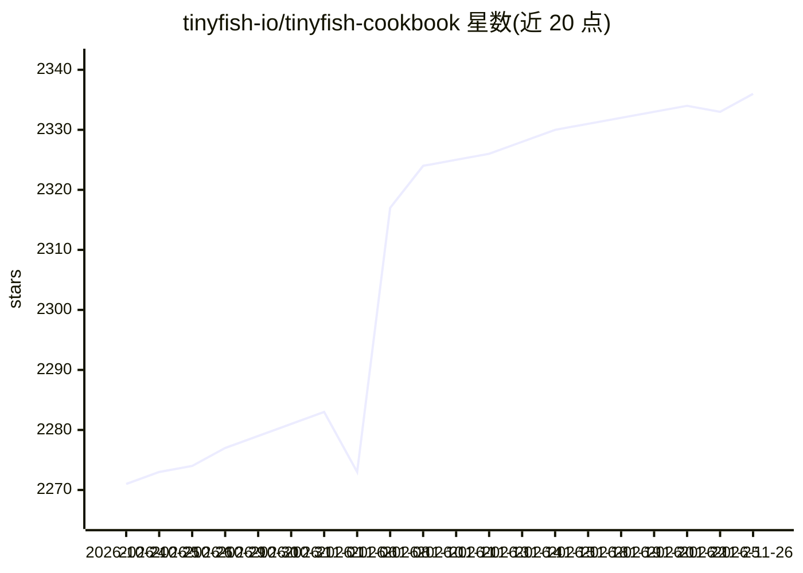

# tinyfish-io/tinyfish-cookbook

⭐ 2,336 · TypeScript · MIT · 推送 2026-11-24 · [GitHub](https://github.com/tinyfish-io/tinyfish-cookbook) · [官网](https://tinyfish.ai) · 组织维护

**面向开发者的 TinyFish Web Agent 示例与配方集**

基于 TinyFish Web Agent 服务构建的示例与配方集合，每个配方为独立项目，按购物比价、旅行住宿、市场研究、教育发现、开发者工具、金融、生活健康等类别组织，并收录黑客松与赏金挑战的获奖作品。仓库同时展示 TinyFish 的四种使用方式：REST API、MCP Server、CLI 与 Agent Skill 安装，并提供 Python/TypeScript SDK 安装命令。Search 与 Fetch 端点免费，Agent 与 Browser 端点按量计费；配方依赖 TinyFish API key 运行。

## 筛选速览

| 维度 | 判定 | 备注 |
|---|---|---|
| AI 角色 | `ai-knowledge` | 知识聚合/清单类 |
| 许可风险 | `permissive` | MIT |
| 部署形态 | `library` | 以包/库形式分发 |
| 模型依赖 | — | README 未给出锁定关系 |
| 硬件要求 | — | 无带数字的原话,不猜 |
| 安装摩擦 | `low` | 无编译、无系统依赖或容器化 |
| 成熟度 | — | 结构信号不足 |

## 能力要点

- 按类别组织的数十个独立配方项目，多数附在线 Demo
- 四种接入方式：REST API、MCP Server、CLI、Agent Skill
- 提供 Python 与 TypeScript SDK（Search/Fetch/Browser/Agent/Vault 全覆盖）
- 附带 n8n 预构建工作流 JSON 可直接导入

## 适用场景

- 学习如何用 TinyFish 把无 API 的网站变成可编程数据源
- 参考现成配方构建比价、招标监控、竞品分析等 Web 自动化应用
- 在 Claude Code/Cursor 等 MCP 客户端中接入 TinyFish 服务
- 用 n8n 工作流定时抓取网站并推送摘要

## 场景标签

`浏览器自动化` `工作流自动化` `编码 Agent` `金融量化` · 领域:效率与自动化

## 证据(README 行号)

> L22: Welcome to the **TinyFish Cookbook!** A growing collection of recipes, demos, and automations built on TinyFish — t
> L114: ## The Recipes
> L116: Each folder is a standalone project. Categorized below by what they do, not what's under the hood.

## 星数曲线

2026-10-24 2,271 → 2026-11-26 2,336（+65）

---
*卡片 v1 · prompt 1.4 · 生成 2026-11-26 · 置信度 high · 依据 README sha `d49db2a13924` · [字段定义](../../DATASET.md)*
