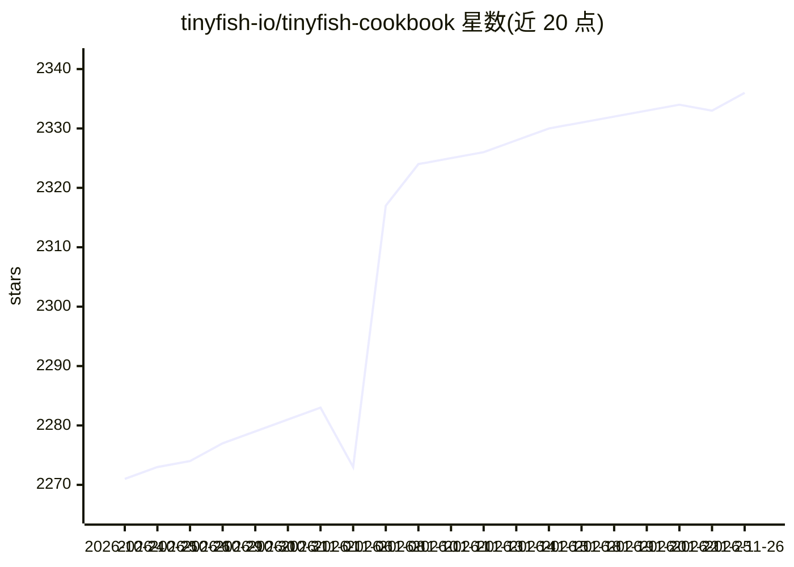

# tinyfish-io/tinyfish-cookbook

⭐ 2,336 · TypeScript · MIT · 推送 2026-11-24 · [GitHub](https://github.com/tinyfish-io/tinyfish-cookbook) · [官网](https://tinyfish.ai) · 组织维护

**基于 TinyFish web agent 的示例应用与 recipes 集合**

TinyFish 官方维护的 cookbook 仓库，收录基于其 web agent 平台构建的示例应用与 recipes：平台提供 Search、Fetch、Agent、Browser 四个端点，分别对应结构化搜索、URL 转 markdown/JSON、自然语言多步浏览器自动化与托管云浏览器；Search 与 Fetch 端点免费。仓库提供 REST API、MCP Server、CLI、Agent Skill、Python/TypeScript SDK 等接入方式，并按购物、旅行、研究、教育、开发者工具、金融等类别组织数十个独立 recipe 项目，含 n8n 工作流示例。

## 筛选速览

| 维度 | 判定 | 备注 |
|---|---|---|
| AI 角色 | `ai-knowledge` | 知识聚合/清单类 |
| 许可风险 | `permissive` | MIT |
| 部署形态 | `library` | 以包/库形式分发 |
| 模型依赖 | — | README 未给出锁定关系 |
| 硬件要求 | — | 无带数字的原话,不猜 |
| 安装摩擦 | `low` | 无编译、无系统依赖或容器化 |
| 成熟度 | — | 结构信号不足 |

## 能力要点

- Search 与 Fetch 端点免费，返回 rank-stable 的 JSON 结果
- Agent 端点接收 URL + 自然语言目标，返回结构化 JSON
- 提供 REST API、MCP Server、CLI、Agent Skill、Python/TypeScript SDK 多种接入方式
- 数十个按类别组织的独立 recipe 项目，含 n8n 工作流

## 适用场景

- 为 agent 接入实时网页搜索与页面读取能力
- 通过示例学习如何把无 API 的网站转为可编程数据源
- 用 MCP Server 在 Claude Code、Cursor 等客户端中调用 web agent
- 参考 recipe 构建比价、聚合、监控类自动化应用

## 场景标签

`浏览器自动化` `网页抓取` `教程课程` · 领域:效率与自动化

## 证据(README 行号)

> L22: Welcome to the **TinyFish Cookbook!** A growing collection of recipes, demos, and automations built on TinyFish — t
> L28: TinyFish gives you four endpoints, layered from lightning-fast retrieval to fully managed browser automation. **Sea
> L116: Each folder is a standalone project. Categorized below by what they do, not what's under the hood.

## 星数曲线

2026-10-24 2,271 → 2026-11-26 2,336（+65）

---
*卡片 v1 · prompt 1.4 · 生成 2026-11-23 · 置信度 high · 依据 README sha `773b4ac022d0` · [字段定义](../../DATASET.md)*
