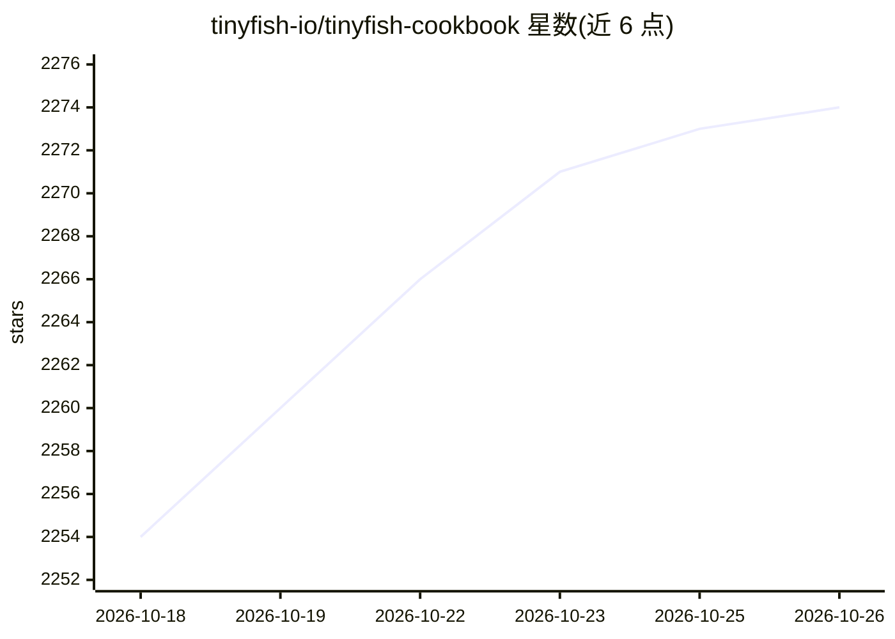

# tinyfish-io/tinyfish-cookbook

⭐ 2,274 · TypeScript · MIT · 推送 2026-10-22 · [GitHub](https://github.com/tinyfish-io/tinyfish-cookbook) · [官网](https://tinyfish.ai) · 组织维护

**TinyFish web agent 的示例应用与配方集合**

TinyFish（面向 AI agent 的 web 层服务）官方社区示例库：每个目录为独立项目，按用途分为精选在线 Demo、AABW 越南黑客松样例、购物比价、旅行住宿、研究与市场情报、教育发现、开发者工具、金融决策、生活健康及 n8n 工作流等类别。同时展示 TinyFish 四个端点（Search/Fetch/Agent/Browser）的接入方式：REST、MCP Server、CLI、Raycast 脚本、Agent Skill 与 Python/TypeScript SDK。代码按 AS-IS 提供，社区贡献不代表官方支持产品。

## 筛选速览

| 维度 | 判定 | 备注 |
|---|---|---|
| AI 角色 | `ai-knowledge` | 知识聚合/清单类 |
| 许可风险 | `permissive` | MIT |
| 部署形态 | `library` | 以包/库形式分发 |
| 模型依赖 | — | README 未给出锁定关系 |
| 硬件要求 | — | 无带数字的原话,不猜 |
| 安装摩擦 | `low` | 无编译、无系统依赖或容器化 |
| 成熟度 | — | 结构信号不足 |

## 能力要点

- 每个配方为独立项目，含多个可在线体验的部署 Demo
- 展示 Search/Fetch/Agent/Browser 四端点的多种接入方式（REST/MCP/CLI/SDK）
- 提供可导入的 n8n 预置工作流
- 声明社区内容 AS-IS，官方无维护义务

## 适用场景

- 学习如何用 TinyFish 为 agent 接入网页搜索、抓取与浏览器自动化
- 寻找比价、竞品监控、房源检索等场景的现成示例项目参考
- 为 Claude Code/Cursor 等编码 agent 安装 use-tinyfish 技能

## 场景标签

`浏览器自动化` `网页抓取` `教程课程` · 领域:效率与自动化

## 证据(README 行号)

> L22: Welcome to the **TinyFish Cookbook!** A growing collection of recipes, demos, and automations built on TinyFish — t
> L116: Each folder is a standalone project. Categorized below by what they do, not what's under the hood.
> L267: This repository is a community-driven space for sharing derivatives, code samples, and best practices related to T

## 星数曲线

2026-10-18 2,254 → 2026-10-26 2,274（+20）

---
*卡片 v1 · prompt 1.4 · 生成 2026-10-21 · 置信度 mid · 依据 README sha `ffecc866acdc` · [字段定义](../../DATASET.md)*
