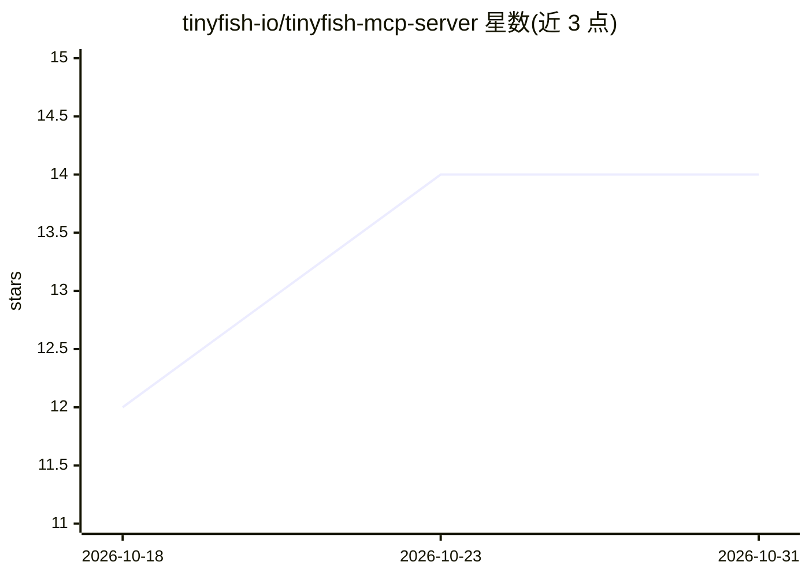

# tinyfish-io/tinyfish-mcp-server

⭐ 14 · TypeScript · MIT · 推送 2026-10-22 · [GitHub](https://github.com/tinyfish-io/tinyfish-mcp-server) · [官网](https://tinyfish.ai) · 组织维护

**TinyFish MCP 服务器的本地反向代理，接入搜索/浏览器自动化工具**

npm 包形式的透明反向代理：在本机 127.0.0.1:3711 暴露 Streamable-HTTP MCP 端点，把所有请求转发到托管的 TinyFish MCP 服务器；代理自身不定义工具与 schema，28 个工具（网页搜索、页面抓取、浏览器自动化、CDP 会话、登录态 Profile、页面监控）均来自上游。适用于客户端只支持本地 MCP 服务器、或需用 API key 认证（CI、无头机器）的场景。固定绑定回环地址，要求 Node.js>=22 与 TINYFISH_API_KEY。

## 筛选速览

| 维度 | 判定 | 备注 |
|---|---|---|
| AI 角色 | `ai-ecosystem` | LLM/agent 周边工具 |
| 许可风险 | `permissive` | MIT |
| 部署形态 | `library` | 以包/库形式分发 |
| 模型依赖 | — | README 未给出锁定关系 |
| 硬件要求 | — | 无带数字的原话,不猜 |
| 安装摩擦 | `low` | 无编译、无系统依赖或容器化 |
| 成熟度 | — | 结构信号不足 |

## 能力要点

- 转发全部 MCP 请求到托管服务器，自身不定义工具
- 通过 TINYFISH_API_KEY 环境变量认证，替代上游 OAuth 流程
- 仅绑定 127.0.0.1，含 Origin 校验防 DNS rebinding
- 支持 npm 全局安装或 npx 免安装运行

## 适用场景

- 让只支持本地 MCP 服务器的客户端接入 TinyFish 托管工具
- 在 CI 或无头机器上用 API key 认证使用搜索与浏览器自动化
- 给 Claude、Cursor、VS Code 等 MCP 客户端配置网页搜索与抓取能力

## 场景标签

`浏览器自动化` `网页抓取` · 领域:效率与自动化

## 证据(README 行号)

> L13: This package is a transparent reverse proxy that exposes a local
> L26: The hosted server exposes 28 tools. You can use them to search the web, fetch and

## 星数曲线

2026-10-18 12 → 2026-10-31 14（+2）

---
*卡片 v1 · prompt 1.4 · 生成 2026-10-31 · 置信度 high · 依据 README sha `1034ef54a832` · [字段定义](../../DATASET.md)*
