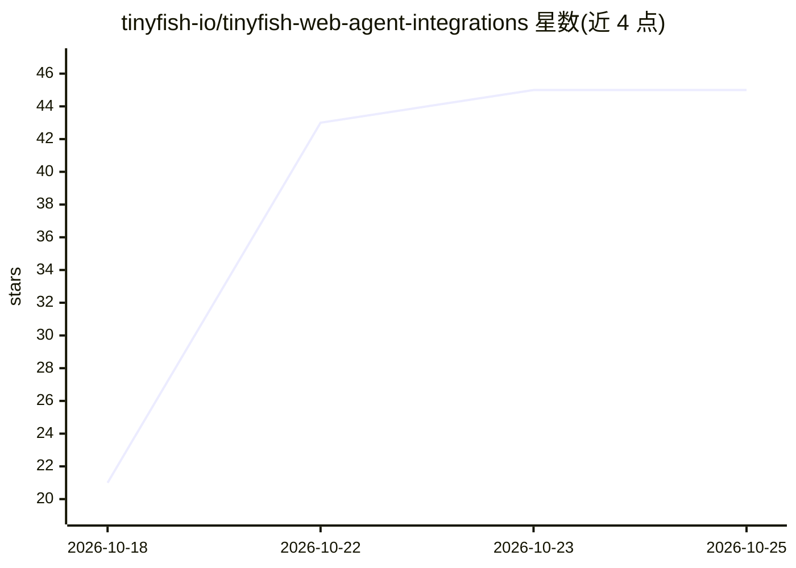

# tinyfish-io/tinyfish-web-agent-integrations

⭐ 45 · Python · MIT · 推送 2026-10-22 · [GitHub](https://github.com/tinyfish-io/tinyfish-web-agent-integrations) · [官网](https://docs.tinyfish.ai) · 组织维护

**将 TinyFish 网页工具接入 AI agent 与工作流平台的集成集合**

TinyFish 官方维护的集成仓库：把托管的网页搜索、页面抓取、目标驱动的浏览器自动化、远程浏览器会话与定时监控等工具，通过 MCP、插件、npm 包或工作流节点接入 Claude、Grok、Hermes、Pi、LangChain、Google ADK、Dify、n8n 等平台。agent 或工作流调用这些集成，由 TinyFish 的托管浏览器执行网页任务并返回结果。Search 与 Fetch 在每日额度内免费，自动化、浏览器会话与监控消耗 TinyFish 钱包余额，需连接 TinyFish 账号。

## 筛选速览

| 维度 | 判定 | 备注 |
|---|---|---|
| AI 角色 | `ai-ecosystem` | LLM/agent 周边工具 |
| 许可风险 | `permissive` | MIT |
| 部署形态 | `None` |  |
| 模型依赖 | locked-api |  |
| 硬件要求 | — | 无带数字的原话,不猜 |
| 安装摩擦 | `low` | 无编译、无系统依赖或容器化 |
| 成熟度 | — | 结构信号不足 |

## 能力要点

- 支持 MCP、LangChain 工具包、Dify 插件、n8n 社区节点等多种接入形态
- Web Agent：给定 URL 与目标，自动导航、点击、填表并返回结果
- 远程浏览器会话可通过 Playwright/Puppeteer 或 CDP 客户端直接控制
- MCP 工具支持已登录站点的浏览器配置文件与定时监控回调 webhook

## 适用场景

- 让我的 agent 具备搜索网页和读取页面内容的能力
- 在 n8n/Dify 工作流中调用浏览器自动化采集数据
- 对页面或搜索主题做定时监控并推送结果

## 场景标签

`浏览器自动化` `网页抓取` · 领域:效率与自动化

## 证据(README 行号)

> L3: Bring TinyFish's web tools into your AI agents and automated workflows.
> L9: High-level diagram: agents and workflows call the integrations in this repository, which connect to TinyFish's hoste
> L17: |Claude|Hosted MCP tools and skills for Claude Code, Claude.ai, Claude Desktop, and Cowork. Covers search, page ext

## 星数曲线

2026-10-18 21 → 2026-10-25 45（+24）

---
*卡片 v1 · prompt 1.4 · 生成 2026-10-25 · 置信度 high · 依据 README sha `afda3a1088b4` · [字段定义](../../DATASET.md)*
