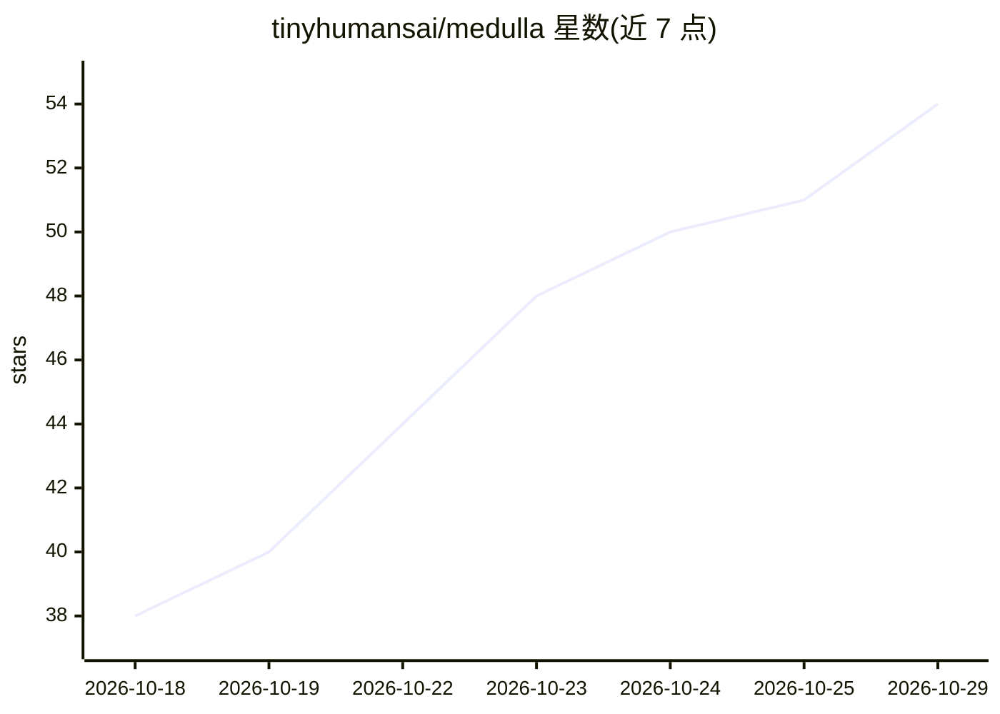

# tinyhumansai/medulla

⭐ 54 · Rust · GPL-3.0 · 推送 2026-10-28 · [GitHub](https://github.com/tinyhumansai/medulla) · [官网](https://tinyhumans.ai/medulla) · 组织维护

**单终端并行管理多机器上多个编码 agent 的终端**

面向使用 Claude Code、Codex、OpenCode 等编码 agent 的开发者的终端工具：每个 agent 或 shell 会话在侧栏以独立 rail 呈现，按键即可切换，后台持续渲染。核心机制包括读取各会话屏幕识别权限提示/崩溃/等待确认等需人工介入的时刻并聚合为警告计数、通过用户自有 ssh 建立远程主机上的 daemon 后以 UDP（mosh 风格）承载连接、会话级 Git diff 查看，以及保存为多步会话的 Workflows。客户端以 Rust 工作区开源（GPL-3.0-only），登录账户 30 天免费，其后需 Basic 或 Pro 付费计划；`medulla --mock` 可离线运行。提供 Linux/macOS/Windows 预编译二进制。

## 筛选速览

| 维度 | 判定 | 备注 |
|---|---|---|
| AI 角色 | `ai-ecosystem` | LLM/agent 周边工具 |
| 许可风险 | `viral` | GPL-3.0 |
| 部署形态 | `None` |  |
| 模型依赖 | — | README 未给出锁定关系 |
| 硬件要求 | — | 无带数字的原话,不猜 |
| 安装摩擦 | `low` | 无编译、无系统依赖或容器化 |
| 成熟度 | — | 结构信号不足 |

## 能力要点

- 多 agent 会话以 rail 并列，按键切换且后台持续运行
- 屏幕读取识别权限提示/崩溃/等待等需人工介入时刻并计数提醒
- 远程主机经自有 ssh 握手后以 UDP 连接承载全部会话，抗断网合盖
- 会话级 Git diff 查看（d 键）与保存的多步骤 Workflows

## 适用场景

- 同时跑多个编码 agent，不再维护一堆终端窗口和 tmux 布局
- 在远程机器上运行 agent 并与本地会话统一管理
- 跨会话集中发现哪些 agent 在等我确认或已崩溃

## 场景标签

`多智能体` · 领域:Agent 开发

## 证据(README 行号)

> L7: Medulla is a terminal for running many coding agents at once. Claude Code, Codex, OpenCode, a plain shell: each one 

## 星数曲线

2026-10-18 38 → 2026-10-29 54（+16）

---
*卡片 v1 · prompt 1.4 · 生成 2026-10-24 · 置信度 high · 依据 README sha `1c479386a40d` · [字段定义](../../DATASET.md)*
