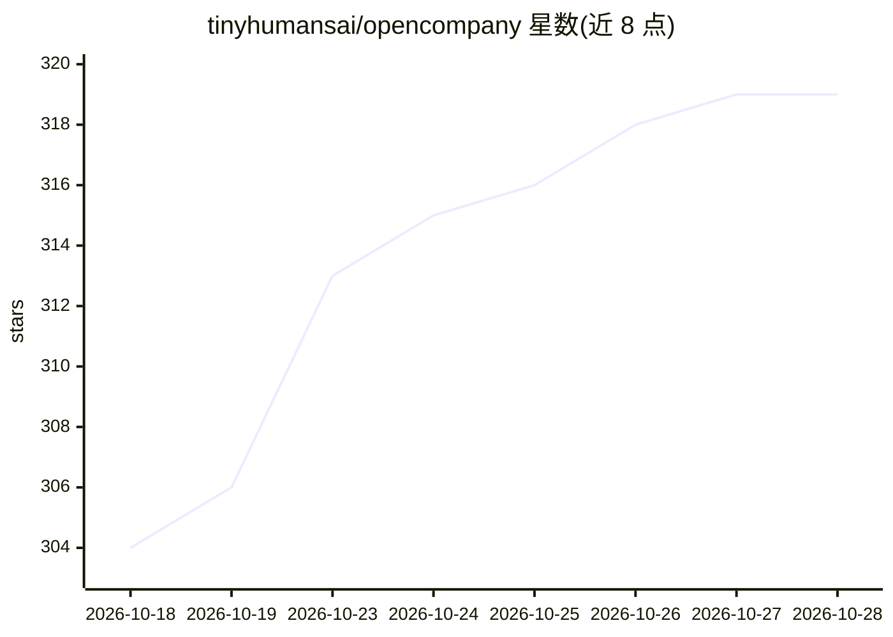

# tinyhumansai/opencompany

⭐ 322 · Rust · GPL-3.0 · 推送 2026-10-09 · [GitHub](https://github.com/tinyhumansai/opencompany) · [官网](https://tinyhumans.ai/opencompany) · 组织维护

**一人公司的多智能体运行时：让 agent 群组代跑各项业务**

面向单人经营者的公司运行时：以 Rust 实现的宿主按 company.toml 实例化一组职能 agent（工程、市场、法务等），以'蜂群' desks 机制在房间内并发对话、互发消息直至任务收敛，路由经 TinyHumans 代理调用 Jev 路由模型，需 TinyHumans API key 才能执行实际工作。内置 22 种业务模板，明示人类保留的审批节点。提供 macOS 桌面安装包、Docker/Podman 快速启动与源码构建三种方式；自托管不外发数据。自述为进行中、非生产就绪。

## 筛选速览

| 维度 | 判定 | 备注 |
|---|---|---|
| AI 角色 | `ai-native` | 本体是模型或模型工具 |
| 许可风险 | `viral` | GPL-3.0 |
| 部署形态 | `desktop` | 安装包/桌面程序 |
| 模型依赖 | — | README 未给出锁定关系 |
| 硬件要求 | — | 无带数字的原话,不猜 |
| 安装摩擦 | `low` | 无编译、无系统依赖或容器化 |
| 成熟度 | `idea` | |

## 能力要点

- 22 种业务模板（软件公司/律所/VC 等）开箱即启动
- desks 蜂群机制：agent 并发对话、DM、广播，episode 有收敛与回合上限
- company.toml 声明角色与权限，opencompany check 校验配置
- 全量日志留痕，重载后可从 journal 重建

## 适用场景

- 我一个人创业，想让 agent 群组代跑市场、工程、支持等职能
- 按业务模板快速启动一个多智能体公司并保留关键审批权
- 自托管运行并审计 agent 之间的全部协作记录

## 场景标签

`多智能体` · 领域:Agent 开发

## 证据(README 行号)

> L7:  OpenCompany is the operating layer for one-person businesses powered by
> L52: That tax is gone. OpenCompany turns a single operator into a full org chart.
> L58: This isn't a chatbot with a to-do list, and it isn't a pipeline of agents

## 星数曲线

2026-10-18 304 → 2026-10-28 319（+15）

---
*卡片 v1 · prompt 1.4 · 生成 2026-10-22 · 置信度 high · 依据 README sha `f242e70c35cd` · [字段定义](../../DATASET.md)*
