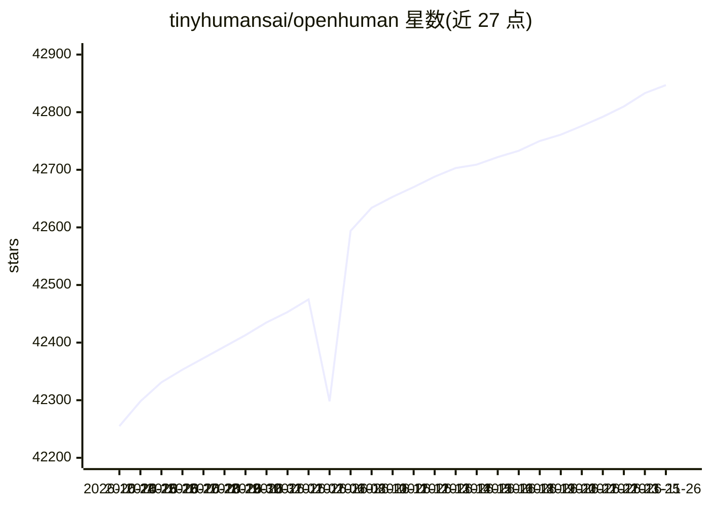

# tinyhumansai/openhuman

⭐ 42,847 · Rust · GPL-3.0 · 推送 2026-11-24 · [GitHub](https://github.com/tinyhumansai/openhuman) · [官网](https://tinyhumans.ai/openhuman) · 组织维护

**面向个人与开发者的多 agent 运行框架（桌面应用+Rust 库）**

用 Rust 编写的 agent harness，提供桌面应用（macOS/Windows/Linux 安装包）、终端应用与可嵌入的 Rust 库三种形态。单进程架构承载多 agent，内置内存（每轮带引用召回）、MCP 与技能、浏览器与桌面控制、14 种消息渠道、可中断语音 agent、工作流图与审批/沙箱安全机制。通过 RLM 压缩工具结果、小模型 Jev 做 1,215 个工具中的检索。模型接入采用 BYOK，支持本地模型与 26 家 provider 的自动路由。当前为早期 beta。

## 筛选速览

| 维度 | 判定 | 备注 |
|---|---|---|
| AI 角色 | `ai-ecosystem` | LLM/agent 周边工具 |
| 许可风险 | `viral` | GPL-3.0 |
| 部署形态 | `desktop` | 安装包/桌面程序 |
| 模型依赖 | local-ok | 支持本地模型 |
| 硬件要求 | — | 无带数字的原话,不猜 |
| 安装摩擦 | `low` | 无编译、无系统依赖或容器化 |
| 成熟度 | `idea` | |

## 动量与使用信号

- 维护:`active` — 距上次 push 1.0 天,年发版 63,180 位贡献者
- 涨星:近 1 天 **+33**(自 20261016 起算)
- 平台:WINDOWS / MACOS / LINUX · 协议:MCP / OLLAMA

## 能力要点

- 单进程 Rust 运行时，可在一个 $10 VPS 上运行 500+ agent
- RLM token 压缩与 Jev 工具检索小模型（1,215 工具 top 命中率 86.8%）
- 内置内存引擎每轮带引用召回，可更换引擎
- 本地模型（Ollama/LM Studio/MLX）与 26 家 provider BYOK，自动模型路由

## 适用场景

- 在低配服务器上以每客户一 agent 的方式运行产品
- 作为 Rust 库把 agent 嵌入自己的项目
- 通过 Telegram/Discord/邮件等渠道部署个人 agent
- 用隐私模式做纯本地运行的桌面助手

## 场景标签

`多智能体` `AI 助手` `Agent 框架` · 领域:Agent 开发

## 证据(README 行号)

> L4:  A desktop app for people. A Rust library for developers.
> L60: Most agent harnesses run one heavy process per agent and resend a big prompt on every call. OpenHuman does the same
> L174: OpenHuman is a library-first harness. Add it to your Rust project and call an agent like any other function, with 

## 星数曲线

2026-10-24 42,255 → 2026-11-26 42,847（+592）

---
*卡片 v1 · prompt 1.4 · 生成 2026-11-22 · 置信度 high · 依据 README sha `a9b5a84e55c5` · [字段定义](../../DATASET.md)*
