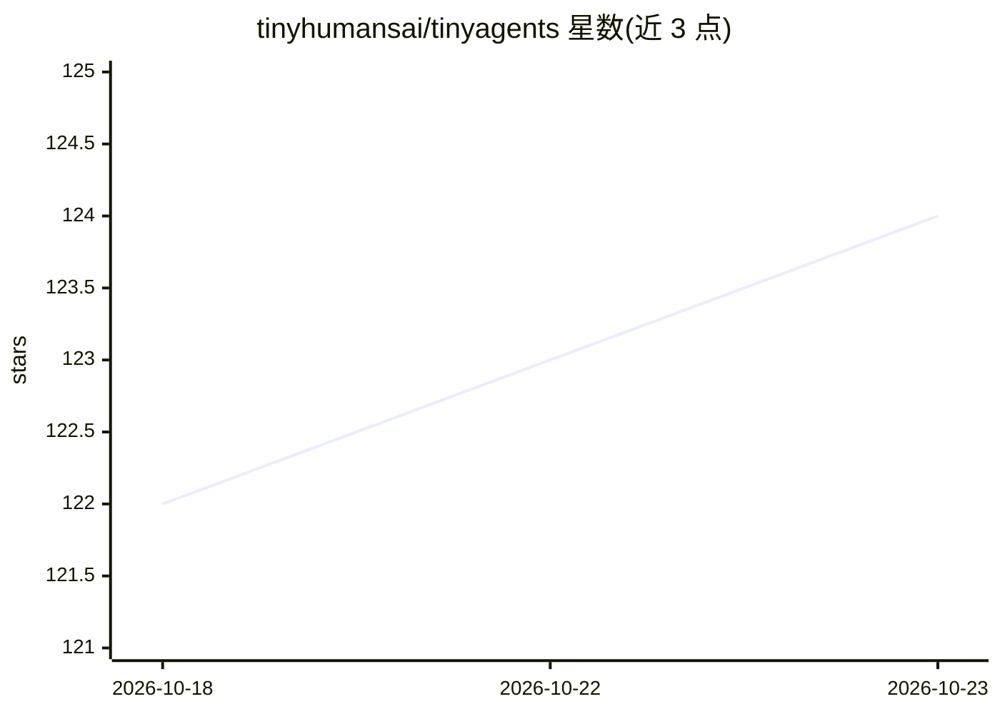

# tinyhumansai/tinyagents

⭐ 124 · Rust · GPL-3.0 · 推送 2026-10-22 · [GitHub](https://github.com/tinyhumansai/tinyagents) · [官网](https://github.com/tinyhumansai/tinyagents/wiki) · 组织维护

**面向 Rust 的供应商中立 agent 框架与持久化状态图运行时**

以 Cargo workspace 形式提供的 Rust agent 框架，包含多个 crate：harness 提供供应商中立的模型调用、类型化工具、中间件、结构化输出与用量/成本核算；graph 提供 LangGraph 风格的持久化类型状态图（checkpoint、中断、子图、时间旅行）；另有会话存储、能力注册表、实时语音 agent 与多 agent 编排等 crate。所有 provider 走 OpenAI Chat Completions 兼容格式，内置 OpenAI/Anthropic/DeepSeek/Groq/xAI/OpenRouter/Together/Mistral/Ollama 预设。crates 未发布到 crates.io，需以 git/path 依赖引入，GPL-3.0-only 许可。

## 筛选速览

| 维度 | 判定 | 备注 |
|---|---|---|
| AI 角色 | `ai-ecosystem` | LLM/agent 周边工具 |
| 许可风险 | `viral` | GPL-3.0 |
| 部署形态 | `library` | 以包/库形式分发 |
| 模型依赖 | local-ok | 支持本地模型 |
| 硬件要求 | — | 无带数字的原话,不猜 |
| 安装摩擦 | `low` | 无编译、无系统依赖或容器化 |
| 成熟度 | — | 结构信号不足 |

## 能力要点

- 供应商中立模型调用，单一 OpenAI 兼容适配器覆盖全部内置 provider（含本地 Ollama）
- 持久化类型状态图：checkpoint、中断、子图、时间旅行、Send fanout
- SQLite 会话存储：历史、工具调用、成本与运行谱系
- 实时语音 agent 会话，工具调用经过统一准入与中间件管线

## 适用场景

- Rust 服务中构建可恢复、可审查的模型/工具循环
- 用类型化状态图编排带 checkpoint 与中断的工作流
- 搭建多 agent 编排与子 agent 调度
- 接入本地或多家 LLM provider 而不绑定单一 SDK

## 场景标签

 · 领域:LLM 基础设施/agent 框架

## 证据(README 行号)

> L8: TinyAgents is a small, provider-neutral agent harness for Rust, plus a durable
> L16: It is for Rust services that need to call models and tools in a loop, want
> L24: - **`tinyagents-harness`** — provider-neutral model calls, typed tools,

## 星数曲线

2026-10-18 122 → 2026-10-23 124（+2）

---
*卡片 v1 · prompt 1.4 · 生成 2026-10-23 · 置信度 high · 依据 README sha `2c1178fc8114` · [字段定义](../../DATASET.md)*
