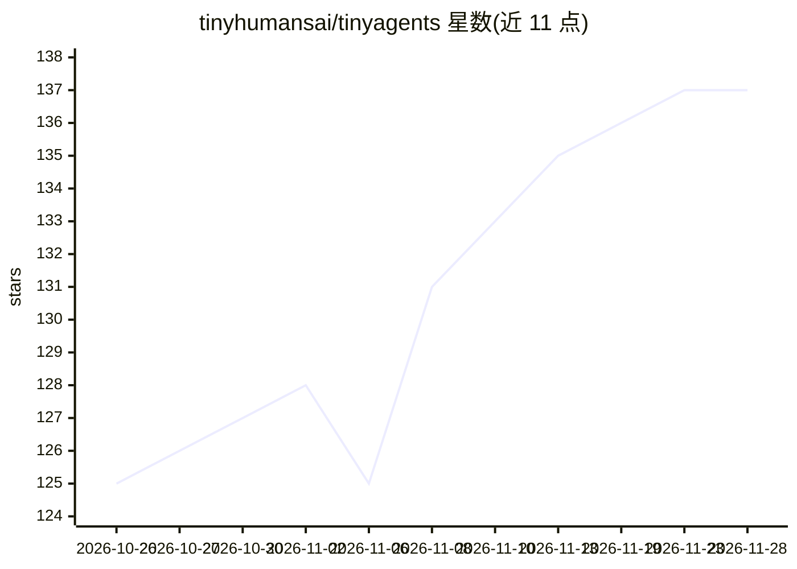

# tinyhumansai/tinyagents

⭐ 137 · Rust · GPL-3.0 · 推送 2026-11-23 · [GitHub](https://github.com/tinyhumansai/tinyagents) · [官网](https://github.com/tinyhumansai/tinyagents/wiki) · 组织维护

**Rust 语言的 provider 中立 agent 框架，供 Rust 服务构建可恢复的模型/工具循环**

以 Cargo workspace 形式组织的 Rust agent 框架，包含 harness（模型调用、typed 工具、中间件、结构化输出、流式、用量/成本核算、重试与缓存）、SQLite 会话存储、能力注册表、子代理编排、实时语音会话等多个 crate。定位为需要循环调用模型与工具、且不希望引入 Python 运行时或框架 DSL 的 Rust 服务。所有 crate 未发布到 crates.io，需以 git 或 path 依赖引入；测试默认离线，真实 provider 验证需自行配置密钥。

## 筛选速览

| 维度 | 判定 | 备注 |
|---|---|---|
| AI 角色 | `ai-ecosystem` | LLM/agent 周边工具 |
| 许可风险 | `viral` | GPL-3.0 |
| 部署形态 | `library` | 以包/库形式分发 |
| 模型依赖 | local-ok | 支持本地模型 |
| 硬件要求 | — | 无带数字的原话,不猜 |
| 安装摩擦 | `low` | 无编译、无系统依赖或容器化 |
| 成熟度 | `idea` | |

## 能力要点

- provider 中立的模型调用，统一走 OpenAI Chat Compatibles wire format，内置 OpenAI/Anthropic/DeepSeek/Groq/xAI/OpenRouter/Together/Mistral/Ollama 预设
- harness 提供模型/工具循环、typed 工具、中间件、结构化输出、流式、用量/成本核算、重试与响应缓存
- SQLite 会话存储、JSONL 转录、任务重启协调与持久化子代理编排
- 内置 Claude Code CLI 模型适配器，支持 stream-json、会话与 MCP 端点

## 适用场景

- 在 Rust 服务中构建模型+工具的 agent 循环，且要求可恢复、可检查
- 用 Rust 替代 Python 框架来编排多代理团队与工作流
- 接入多个 OpenAI 兼容端点（含本地 Ollama）做模型调用与成本核算
- 为实时语音代理会话执行宿主侧工具准入与中间件策略

## 场景标签

`Agent 框架` `多智能体` `工作流自动化` · 领域:Agent 开发

## 证据(README 行号)

> L8: TinyAgents is a small, provider-neutral agent harness for Rust. It takes its
> L13: It is for Rust services that need to call models and tools in a loop, want
> L86: `tinyagents-harness` runs the model/tool agent loop: provider-neutral model

## 星数曲线

2026-10-26 125 → 2026-11-28 137（+12）

---
*卡片 v1 · prompt 1.4 · 生成 2026-11-28 · 置信度 high · 依据 README sha `e7e1e28515e8` · [字段定义](../../DATASET.md)*
