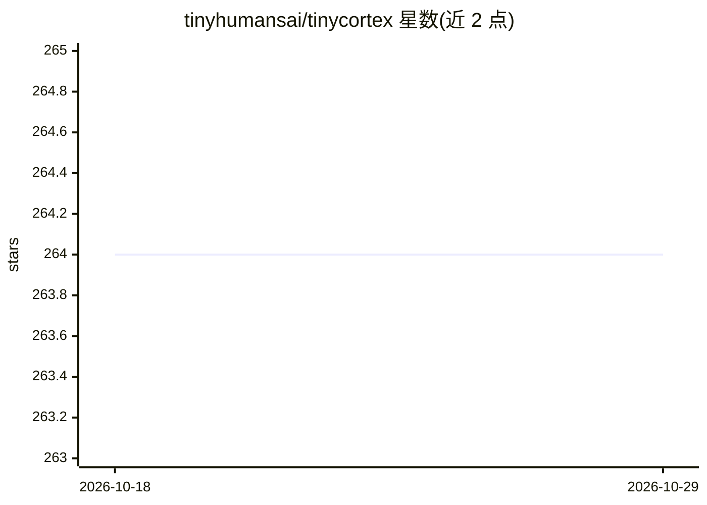

# tinyhumansai/tinycortex

⭐ 264 · Rust · GPL-3.0 · 推送 2026-10-26 · [GitHub](https://github.com/tinyhumansai/tinycortex) · [官网](https://tinyhumans.gitbook.io/neocortex/) · 组织维护

**给 agent 开发者的本地优先 AI 记忆引擎 Rust 库**

以 Rust 库（crates.io 发布为 tinycortex）形式提供的记忆引擎，嵌入到用户自己的 agent、服务或应用中。机制：摄入时多信号准入门过滤低价值内容，Markdown 文件为事实源，SQLite/摘要树/向量等为可重建的派生索引；检索提供语义、关键词、图、新鲜度衰减与可组合混合评分等策略原语。可选 Cargo 特性启用 tokio 调度、git 快照与 Composio 同步。README 中的 RAGAS/TemporalBench/Vending-Bench 基准由闭源 alpha 托管平台测得，仓库内仅含检索有效性测试工具。

## 筛选速览

| 维度 | 判定 | 备注 |
|---|---|---|
| AI 角色 | `ai-ecosystem` | LLM/agent 周边工具 |
| 许可风险 | `viral` | GPL-3.0 |
| 部署形态 | `library` | 以包/库形式分发 |
| 模型依赖 | — | README 未给出锁定关系 |
| 硬件要求 | — | 无带数字的原话,不猜 |
| 安装摩擦 | `low` | 无编译、无系统依赖或容器化 |
| 成熟度 | `idea` | |

## 能力要点

- 多信号准入门在摄入时丢弃低价值内容
- Markdown 为事实源，其余索引均可从内容重建
- 语义/关键词/图/新鲜度等可组合检索评分原语
- git-diff 特性提供基于 Git 的快照与变更感知

## 适用场景

- 为自己的 agent 或服务嵌入带遗忘机制的长期记忆
- 在本地以可检查的 Markdown 文件管理 AI 记忆
- 为 RAG/对话系统提供带时间衰减的检索策略原语

## 场景标签

`Agent 记忆` · 领域:Agent 开发

## 证据(README 行号)

> L19: > **What this repository is:** the open-source **Rust core** of TinyCortex — the local-first memory engine — publis
> L45: TinyCortex is a Rust library. Add it to your project (the example below also uses `tokio` and `anyhow`, which are n

## 星数曲线

2026-10-18 264 → 2026-10-29 264（+0）

---
*卡片 v1 · prompt 1.4 · 生成 2026-10-22 · 置信度 high · 依据 README sha `36670a4be385` · [字段定义](../../DATASET.md)*
