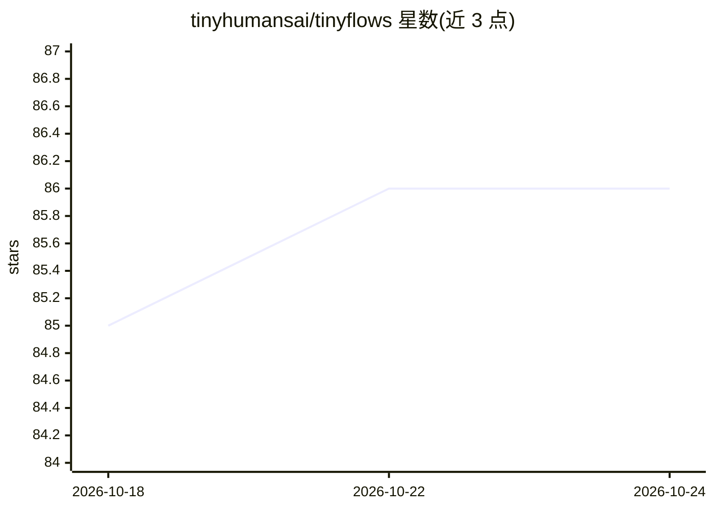

# tinyhumansai/tinyflows

⭐ 86 · Rust · GPL-3.0 · 推送 2026-10-23 · [GitHub](https://github.com/tinyhumansai/tinyflows) · [官网](https://crates.io/crates/tinyflows) · 组织维护

**Rust 工作流自动化引擎库：供宿主应用构建运行 agentic 工作流**

以 library crate 形式提供的 Rust 原生工作流自动化引擎：将自动化建模为类型化节点组成的有向图（WorkflowGraph），经校验、编译后由 engine::run 驱动执行。设计上主机无关：LLM、工具调用、HTTP、代码执行、持久化等外部交互均通过宿主实现的 capability trait（LlmProvider、ToolInvoker 等）接入，crate 本身不硬编码任何厂商。节点目录覆盖 agent、tool_call、code、shell、sub_workflow 等十余种，支持并行 fan-out、merge 屏障、错误处理、审批门控与断点续跑；另提供 testkit 调试工具与 PNG/JPEG 图渲染。Rust 2024、MSRV 1.85、GPL-3.0-or-later。

## 筛选速览

| 维度 | 判定 | 备注 |
|---|---|---|
| AI 角色 | `ai-ecosystem` | LLM/agent 周边工具 |
| 许可风险 | `viral` | GPL-3.0 |
| 部署形态 | `library` | 以包/库形式分发 |
| 模型依赖 | — | README 未给出锁定关系 |
| 硬件要求 | — | 无带数字的原话,不猜 |
| 安装摩擦 | `low` | 无编译、无系统依赖或容器化 |
| 成熟度 | `idea` | |

## 能力要点

- 类型化 WorkflowGraph 编译执行，含并行 fan-out、merge 屏障与 per-item 数据流
- 主机无关设计：LLM/工具/HTTP/代码执行经宿主实现 capability trait 注入
- 人工审批门控（requires_approval/approval 节点）与 Checkpointer 跨进程续跑
- testkit 提供可编程 mock、结构化运行轨迹、断点与 agent 可用的 JSON 工具接口

## 适用场景

- 在 Rust 应用中嵌入 agentic 工作流编排能力
- 构建含人工审批环节的自动化流程
- 对工作流做断点调试与可视化（PNG/JPEG 渲染）

## 场景标签

 · 领域:LLM 基础设施/工作流编排

## 证据(README 行号)

> L3: **A Rust-native, host-agnostic workflow automation engine, shipped as a library
> L10: everything that touches the outside world — LLMs, integration tools, HTTP, code
> L79: - Host-injected capability traits: `LlmProvider`, `ToolInvoker`, `HttpClient`,

## 星数曲线

2026-10-18 85 → 2026-10-24 86（+1）

---
*卡片 v1 · prompt 1.4 · 生成 2026-10-24 · 置信度 high · 依据 README sha `3218d9797374` · [字段定义](../../DATASET.md)*
