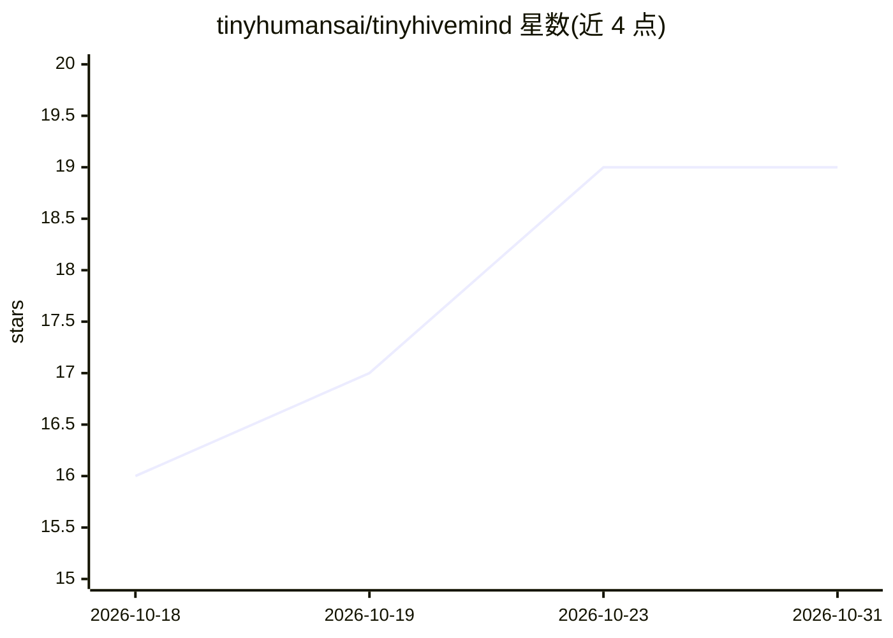

# tinyhumansai/tinyhivemind

⭐ 19 · Rust · GPL-3.0 · 推送 2026-10-25 · [GitHub](https://github.com/tinyhumansai/tinyhivemind) · [官网](https://github.com/tinyhumansai/tinyhivemind/wiki) · 个人维护

**Rust 多智能体群体决策协调库：法定人数、印记衰减等机制**

面向构建 agent 应用的开发者的 Rust 库，实现受生物群体启发的协调机制：stigmergy（痕迹驱动工作）、信息素衰减、法定人数感知、交叉抑制、响应阈值，以固定点整数折叠方式作用于宿主自有的会话记录（transcript）。宿主暴露工具接口，库通过 step 折叠返回下一步动作；提供轮替/桌面（desk）隔离、提及语法、单视角投影、referral 跨桌询问与可命名的终止状态（Converged/deadlocked/exhausted/idle）。全部为定点整数运算，同记录可逐字节回放。README 附带合成决策任务与多桌基准数据；referral 机制默认关闭。可见范围内未展示安装命令，仅链接 Quick start 与 Wiki。

## 筛选速览

| 维度 | 判定 | 备注 |
|---|---|---|
| AI 角色 | `ai-ecosystem` | LLM/agent 周边工具 |
| 许可风险 | `viral` | GPL-3.0 |
| 部署形态 | `None` |  |
| 模型依赖 | — | README 未给出锁定关系 |
| 硬件要求 | — | 无带数字的原话,不猜 |
| 安装摩擦 | `low` | 无编译、无系统依赖或容器化 |
| 成熟度 | — | 结构信号不足 |

## 能力要点

- 五种群体机制（stigmergy/信息素衰减/法定人数/交叉抑制/响应阈值）以整数折叠实现
- 宿主持有会话记录，工具由宿主自身接口暴露
- desk 作为相关性边界，referral 跨桌往返恰好两跳
- 终止可保证（有限轮次预算），状态可逐字节回放

## 适用场景

- 为多 agent 系统提供有依据的群体决策与异议机制
- 跨多个 agent 组协同决策，隔离相关误差
- 需要可审计、可复现的多智能体审议流程

## 场景标签

`Agent 框架` `多智能体` · 领域:Agent 开发

## 证据(README 行号)

> L5: Quorum sensing, cross-inhibition, stigmergy, salience decay and response
> L48: fold reads what you hand it and returns what should happen next. The host owns
> L145: The mechanics need a room to run in, so tinyhivemind owns that too, and it is

## 星数曲线

2026-10-18 16 → 2026-10-31 19（+3）

---
*卡片 v1 · prompt 1.4 · 生成 2026-10-28 · 置信度 mid · 依据 README sha `30c683ea66a7` · [字段定义](../../DATASET.md)*
