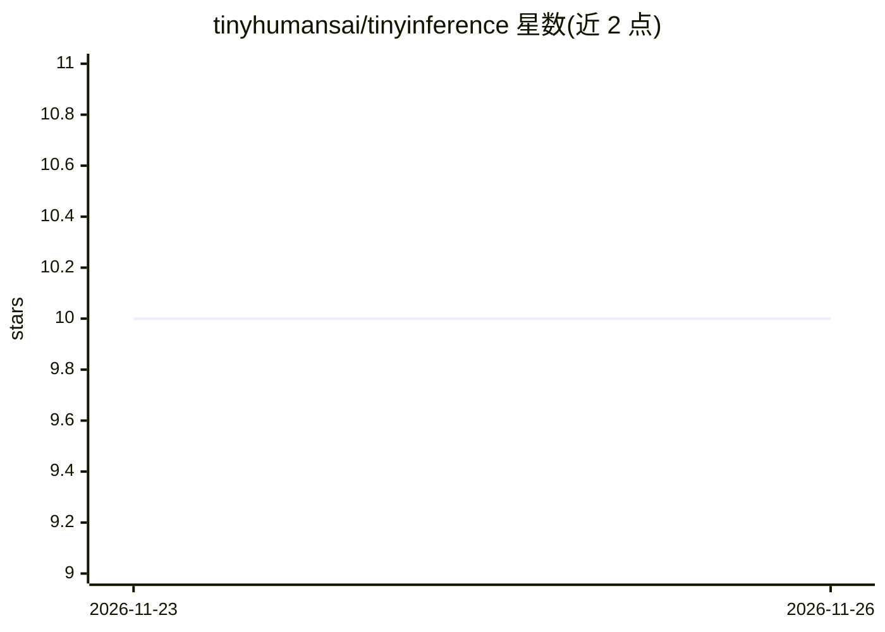

# tinyhumansai/tinyinference

⭐ 10 · Rust · GPL-3.0 · 推送 2026-11-22 · [GitHub](https://github.com/tinyhumansai/tinyinference) · 组织维护

**面向 AI agent 运行时的 Rust 模型与嵌入 API 接入层**

TinyInference 是被 TinyHumans AI agent 运行时共享的 Rust 库，只负责模型与嵌入 API 相关事务，不包含 agent 循环、图运行时、中间件等。提供 provider 中立的消息/工具调用/请求响应结构、异步流式 ChatModel 抽象、多家服务商适配器、嵌入与 Voyage 重排序、本地推理端点探测（不下载模型、不安装或启停运行时）、OAuth/PKCE 凭据处理、图像与视频生成传输。以多个 crate 拆分（llm/embeddings/local/providers/voice/image/video/decisions/core）。许可证 GPL-3.0-only。

## 筛选速览

| 维度 | 判定 | 备注 |
|---|---|---|
| AI 角色 | `ai-ecosystem` | LLM/agent 周边工具 |
| 许可风险 | `viral` | GPL-3.0 |
| 部署形态 | `None` |  |
| 模型依赖 | local-ok | 支持本地模型 |
| 硬件要求 | — | 无带数字的原话,不猜 |
| 安装摩擦 | `low` | 无编译、无系统依赖或容器化 |
| 成熟度 | — | 结构信号不足 |

## 能力要点

- provider 中立的 ChatModel 抽象与真实异步流式
- OpenAI 兼容适配器覆盖 Anthropic、Ollama、DeepSeek、Groq 等
- 端点式本地推理：可达性探测、已装模型发现与推理
- Voyage 重排序：取消、有界重试、provider 用量回报

## 适用场景

- 为 Rust 应用统一接入多家 LLM 服务商
- 对接用户已安装的本地推理端点（Ollama/LM Studio 等）
- 在检索系统中嵌入文档重排序步骤

## 场景标签

`模型网关` · 领域:Agent 开发

## 证据(README 行号)

> L3: TinyInference is the provider-facing Rust layer shared by TinyHumans AI agent
> L12: - OpenAI Chat Completions, OpenAI Responses, and OpenAI-compatible provider
> L46: TinyAgents vendors this repository at `vendor/tinyinference` and re-exports the

## 星数曲线

2026-11-23 10 → 2026-11-26 10（+0）

---
*卡片 v1 · prompt 1.4 · 生成 2026-11-23 · 置信度 high · 依据 README sha `2a495661b266` · [字段定义](../../DATASET.md)*
