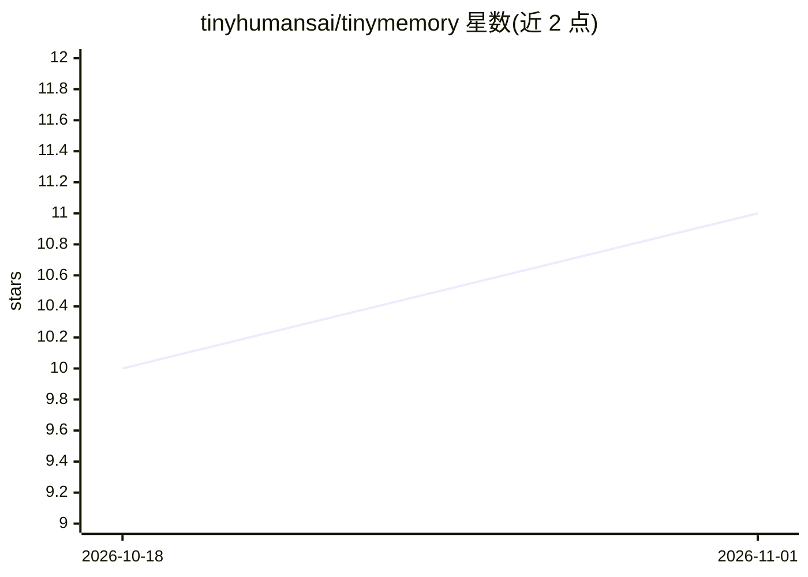

# tinyhumansai/tinymemory

⭐ 11 · Rust · GPL-3.0 · 推送 2026-10-30 · [GitHub](https://github.com/tinyhumansai/tinymemory) · 组织维护

**面向 Agent 的标准化记忆层：可插拔引擎上的存取与召回**

Rust 工作区形式的记忆系统，由 tinymemory-api（契约）、tinymemory-tools 与 tinymemory-integrations 三个 crate 加独立 tinyredact 库组成。核心操作为 recall（带引用的合成回答）、fetch（关键词/向量/混合检索）与 store（文档、会话、学习项入库），配合命名空间树隔离租户与 Agent；可将存储内容编译为 token 预算内的 context.md 供会话开场，AgentMemory 覆盖 pre_turn/post_turn 生命周期。默认启用 CortexDB 引擎，亦可实现 MemoryEngine trait 接入其他引擎。未发布到 crates.io，需以 git + tag 方式依赖引入。

## 筛选速览

| 维度 | 判定 | 备注 |
|---|---|---|
| AI 角色 | `ai-ecosystem` | LLM/agent 周边工具 |
| 许可风险 | `viral` | GPL-3.0 |
| 部署形态 | `library` | 以包/库形式分发 |
| 模型依赖 | — | README 未给出锁定关系 |
| 硬件要求 | — | 无带数字的原话,不猜 |
| 安装摩擦 | `low` | 无编译、无系统依赖或容器化 |
| 成熟度 | — | 结构信号不足 |

## 能力要点

- recall/fetch/store 三操作 + 命名空间树隔离租户与 Agent
- token 预算的 context.md 编译与 AgentMemory 生命周期钩子
- 可插拔引擎架构，实现 MemoryEngine trait 并跑 conformance 即可注册
- 文档格式嗅ing、PDF/DOCX/PPTX 转 markdown、秘密与 PII 清洗等可选 feature

## 适用场景

- 为自己的 Agent 接入可插拔的长期记忆（文档、会话、学习项）
- 每轮对话自动召回与记录，并在开场注入编译好的 context.md
- 多租户/多 Agent 场景下隔离与管理各自的记忆作用域

## 场景标签

`Agent 记忆` · 领域:Agent 开发

## 证据(README 行号)

> L3: The memory layer for TinyHumans agents: **recall, fetch and store** over
> L31: ├── tinymemory-api/           the contract: `MemoryEngine`, `StoreItem`, `MemoryMeta`,
> L108: For memory around every turn, use `tinymemory_tools::AgentMemory`. It

## 星数曲线

2026-10-18 10 → 2026-11-01 11（+1）

---
*卡片 v1 · prompt 1.4 · 生成 2026-11-01 · 置信度 high · 依据 README sha `ec2f2cbbfc29` · [字段定义](../../DATASET.md)*
