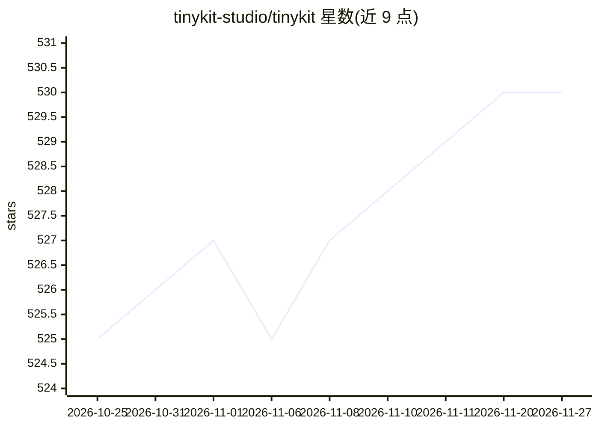

# tinykit-studio/tinykit

⭐ 530 · Svelte · MIT · 推送 2026-11-09 · [GitHub](https://github.com/tinykit-studio/tinykit) · [官网](https://tinykit.studio) · 组织维护

**自托管的 AI 应用构建平台，含实时数据库与部署**

Tinykit 是开源的 AI Web 应用构建与部署平台：通过提示让 AI 编写代码、创建数据表与字段并完成接联，内置基于 PocketBase 的实时数据库、文件存储、单文件 Svelte 代码编辑器、内容字段（类迷你 CMS）、可视化设计系统编辑与每次变更的快照回退。支持通过 OpenAI 兼容的自定义端点接入本地/自定义模型服务器，也可从模板出发、在不配置 LLM API key 的情况下使用。一台服务器可挂载多域名运行多个应用。当前处于早期 alpha 阶段，不包含本地 coding-agent 与订阅制集成。

## 筛选速览

| 维度 | 判定 | 备注 |
|---|---|---|
| AI 角色 | `ai-native` | 本体是模型或模型工具 |
| 许可风险 | `permissive` | MIT |
| 部署形态 | `self-host` | docker 或自建部署 |
| 模型依赖 | locked-api |  |
| 硬件要求 | — | 无带数字的原话,不猜 |
| 安装摩擦 | `low` | 无编译、无系统依赖或容器化 |
| 成熟度 | `idea` | |

## 能力要点

- 提示 AI 生成代码、建表建字段并完成接联的 agentic builder
- 内置 PocketBase 实时数据库与图片/文件存储
- BYO LLM：OpenAI、Anthropic、Gemini、DeepSeek 或 OpenAI 兼容自定义端点
- 内容字段与设计系统可视化编辑、变更快照回退

## 适用场景

- 在自有服务器上用提示词构建内部工具与 CRUD 应用
- 一台服务器绑定多个域名运行多个小型应用
- 不用 AI 也能从模板改代码和内容建应用

## 场景标签

`代码生成` · 领域:编码与开发

## 证据(README 行号)

> L30: Tinykit is an open-source platform for building and deploying web apps with AI. It manages code, database, content,
> L34: - **Agentic Builder**: Prompt the AI to write code, create fields and tables, and wire it all up.
> L42: - **Bring Your Own LLM**: OpenAI, Anthropic, Gemini, DeepSeek, or a compatible local/custom server.

## 星数曲线

2026-10-25 525 → 2026-11-27 530（+5）

---
*卡片 v1 · prompt 1.4 · 生成 2026-11-25 · 置信度 high · 依据 README sha `812635264cc2` · [字段定义](../../DATASET.md)*
