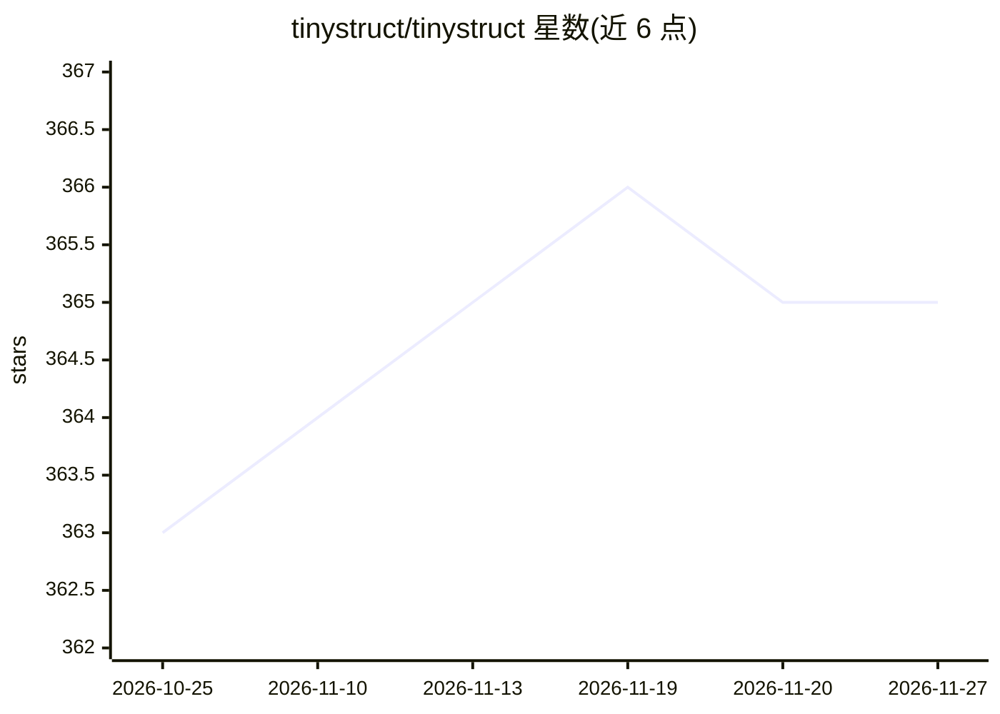

# tinystruct/tinystruct

⭐ 365 · Java · Apache-2.0 · 推送 2026-11-25 · [GitHub](https://github.com/tinystruct/tinystruct) · [官网](https://tinystruct.org) · 组织维护 · 中文 README

**Java Web/CLI 开发框架，供开发者构建可接入 AI 的模块化应用**

轻量级模块化 Java 应用框架，统一支持 Web 与 CLI 两种运行形态：无需 main 方法，通过 bin/dispatcher 命令启动；内置轻量 HTTP 服务器（集成 Netty/Tomcat 生命周期）；基于 @Action 注解路由；按 plugin 架构组织应用；README 声明面向 AI 集成场景，脚手架提供 basic/web/mcp/workflow/agent 五类项目模板。要求 JDK 17+ 与 Maven，以 Maven Central 依赖或脚本/源码方式获取，Apache 2.0 许可。

## 筛选速览

| 维度 | 判定 | 备注 |
|---|---|---|
| AI 角色 | `ai-ecosystem` | LLM/agent 周边工具 |
| 许可风险 | `permissive` | Apache-2.0 |
| 部署形态 | `None` |  |
| 模型依赖 | — | README 未给出锁定关系 |
| 硬件要求 | — | 无带数字的原话,不猜 |
| 安装摩擦 | `medium` | 含编译或系统依赖之一 |
| 成熟度 | — | 结构信号不足 |

## 能力要点

- CLI 与 Web 统一设计，同一代码库以 dispatcher 命令或 HTTP 服务运行
- 内置轻量 HTTP 服务器，无需外置容器
- @Action 注解路由与插件化架构
- 脚手架支持 basic/web/mcp/workflow/agent 五种项目模板

## 适用场景

- 用 Java 快速搭建 CLI 工具与脚本自动化程序
- 搭建内置 HTTP 服务的 Web 应用
- 基于 agent/workflow 模板构建 AI 集成应用

## 场景标签

`Agent 框架` · 领域:Agent 开发

## 证据(README 行号)

> L29: You can follow this archetype to create a tinystruct-based project quickly: https://github.com/tinystruct/tinystruc
> L31: Or create a project with a single command (Linux/macOS, requires JDK 17+ and Maven; choose basic, web, mcp, workflo
> L119:  Unlike Spring Boot which is primarily web-centric, **tinystruct** treats CLI and Web as equal citizens. This make

## 星数曲线

2026-10-25 363 → 2026-11-27 365（+2）

---
*卡片 v1 · prompt 1.4 · 生成 2026-11-26 · 置信度 high · 依据 README sha `dc8988153a99` · [字段定义](../../DATASET.md)*
