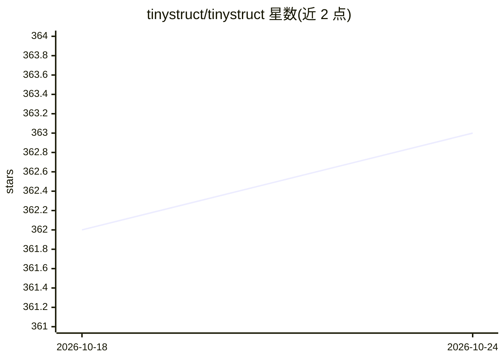

# tinystruct/tinystruct

⭐ 363 · Java · Apache-2.0 · 推送 2026-10-23 · [GitHub](https://github.com/tinystruct/tinystruct) · [官网](https://tinystruct.org) · 组织维护

**面向 Java 开发者的轻量模块化 Web/CLI 应用框架，支持 AI 集成**

tinystruct 是一个 Java 应用框架（要求 JDK 17+、Maven），统一 CLI 与 Web 两种运行形态：应用无需 main() 方法，通过 bin/dispatcher 命令启动，内置轻量 HTTP 服务器，采用 @Action 注解路由与最小化配置。项目创建脚本提供 basic、web、mcp、workflow、agent 五种原型，主题标签与原型指向 MCP 服务器与 AI agent 开发场景。README 含基准测试数据（约 86,000 req/s）与 Spring Boot 的设计差异说明。以 Maven 依赖或独立 jar 形式分发，Apache-2.0 许可。

## 筛选速览

| 维度 | 判定 | 备注 |
|---|---|---|
| AI 角色 | `ai-ecosystem` | LLM/agent 周边工具 |
| 许可风险 | `permissive` | Apache-2.0 |
| 部署形态 | `None` |  |
| 模型依赖 | — | README 未给出锁定关系 |
| 硬件要求 | — | 无带数字的原话,不猜 |
| 安装摩擦 | `medium` | 含编译或系统依赖之一 |
| 成熟度 | — | 结构信号不足 |

## 能力要点

- 无需 main() 方法，bin/dispatcher 统一驱动 CLI 与 Web 运行
- 内置轻量 HTTP 服务器，@Action 注解路由
- 项目创建脚本提供 mcp/workflow/agent 原型
- Maven Central 发布，支持独立 jar 打包（约 50 MB）

## 适用场景

- 用同一代码库构建命令行工具和 Web 服务
- 搭建 MCP 服务器或 AI agent 应用的 Java 骨架
- 追求低配置、注解路由的轻量 Java 后端开发

## 场景标签

 · 领域:软件开发框架

## 证据(README 行号)

> L31: Or create a project with a single command (Linux/macOS, requires JDK 17+ and Maven; choose basic, web, mcp, workflo
> L118: 2. **Unified design for CLI and Web**

## 星数曲线

2026-10-18 362 → 2026-10-24 363（+1）

---
*卡片 v1 · prompt 1.4 · 生成 2026-10-21 · 置信度 mid · 依据 README sha `e6aa942e0918` · [字段定义](../../DATASET.md)*
