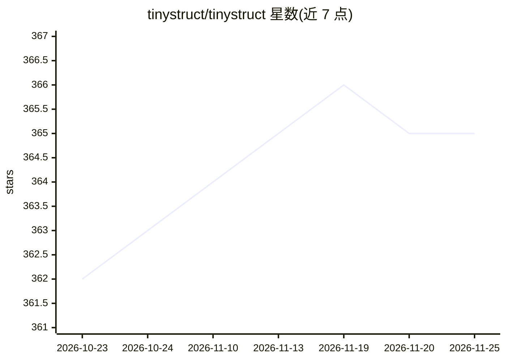

# tinystruct/tinystruct

⭐ 365 · Java · Apache-2.0 · 推送 2026-11-23 · [GitHub](https://github.com/tinystruct/tinystruct) · [官网](https://tinystruct.org) · 组织维护 · 中文 README

**面向 Web 与 CLI 的轻量级模块化 Java 应用框架**

基于 Java 17 的应用框架，统一支持 CLI 与 Web 两种运行形态：应用通过继承 AbstractApplication 编写，以 @Action 注解做路由，无需 main() 方法即可用 bin/dispatcher 命令启动；内置 HTTP 服务器，可选 Netty/Tomcat。提供 Maven 依赖引入、脚手架原型与一键创建脚本，创建项目时可选 basic、web、mcp、workflow 或 agent 模板。README 描述其为面向 AI 集成与插件化架构设计，附 Apache 2.0 许可。

## 筛选速览

| 维度 | 判定 | 备注 |
|---|---|---|
| AI 角色 | `ai-ecosystem` | LLM/agent 周边工具 |
| 许可风险 | `permissive` | Apache-2.0 |
| 部署形态 | `None` |  |
| 模型依赖 | — | README 未给出锁定关系 |
| 硬件要求 | — | 无带数字的原话,不猜 |
| 安装摩擦 | `medium` | 含编译或系统依赖之一 |
| 成熟度 | — | 结构信号不足 |

## 能力要点

- 统一 CLI 与 Web 的应用设计，同一代码库两种运行方式
- 注解路由（@Action）与无 main() 启动的 dispatcher 命令行工具
- 内置 HTTP 服务器生命周期管理（Netty/Tomcat 集成）
- 项目脚手架可选 basic、web、mcp、workflow、agent 模板

## 适用场景

- 用 Java 快速搭建命令行工具与 HTTP 服务
- 按 agent/workflow 模板创建基于该框架的项目
- 以 Maven 依赖方式在既有 Java 工程中引入该框架

## 场景标签

`Agent 框架` · 领域:Agent 开发

## 证据(README 行号)

> L31: Or create a project with a single command (Linux/macOS, requires JDK 17+ and Maven; choose basic, web, mcp, workflo
> L118: 2. **Unified design for CLI and Web**
> L119:  Unlike Spring Boot which is primarily web-centric, **tinystruct** treats CLI and Web as equal citizens. This make

## 星数曲线

2026-10-23 362 → 2026-11-25 365（+3）

---
*卡片 v1 · prompt 1.4 · 生成 2026-11-25 · 置信度 mid · 依据 README sha `7d9400c6bb94` · [字段定义](../../DATASET.md)*
