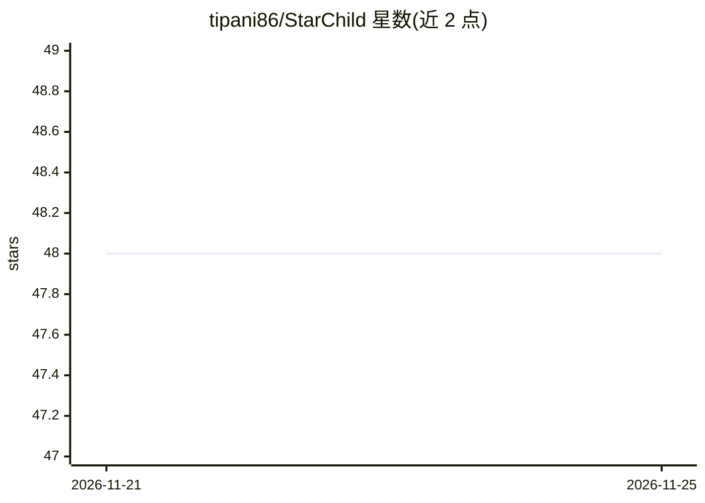

# tipani86/StarChild

⭐ 48 · C# · 推送 2026-11-02 · [GitHub](https://github.com/tipani86/StarChild) · 个人维护 · 中文 README

**为孤独症儿童设计的微信聊天机器人图形匹配训练游戏**

基于 Wechaty 的聊天机器人游戏：从圆形/正方形/三角形中随机抽取目标图形，儿童拍摄真实物体照片发回，由独立的 Python 图像识别服务（Flask + Docker，HTTP API 对接）判断匹配度并反馈，依据 ABA 应用行为分析的感知与思维训练内容设计。核心 Wechaty 模块为 C#，通过微信 Puppet 代理登录收发消息；儿童积累星星可兑换更多图形模板并在社区 PK。模型需另行从 Google Drive/百度网盘下载。

## 筛选速览

| 维度 | 判定 | 备注 |
|---|---|---|
| AI 角色 | `ai-native` | 本体是模型或模型工具 |
| 许可风险 | `none` | — |
| 部署形态 | `self-host` | docker 或自建部署 |
| 模型依赖 | — | README 未给出锁定关系 |
| 硬件要求 | — | 无带数字的原话,不猜 |
| 安装摩擦 | `low` | 无编译、无系统依赖或容器化 |
| 成熟度 | — | 结构信号不足 |

## 能力要点

- 随机图形→拍照→识别→反馈的回合制游戏流程
- Wechaty(C#) 聊天模块与 Python Flask 图像识别服务通过 HTTP API 解耦
- CV 模块提供 Docker 镜像构建与运行命令，监听 1337 端口
- 图像识别算法基于 SCRN 论文的预训练模型

## 适用场景

- 孤独症儿童在家进行物品归类类的认知训练
- 通过微信聊天界面与机器人互动完成图形匹配游戏
- 儿童之间在社区进行匹配游戏 PK

## 场景标签

`聊天机器人` `目标检测` · 领域:对话与助手

## 证据(README 行号)

> L13: |Game Mechanics To stick with the universal design principle, we chose a cognitive improvement perspective that is 
> L19: |Technical Documentation Solution (Left-to-Right) The chatroom, where all the messaging happens back and forth betw

## 星数曲线

2026-11-21 48 → 2026-11-25 48（+0）

---
*卡片 v1 · prompt 1.4 · 生成 2026-11-21 · 置信度 high · 依据 README sha `515c3d4a314b` · [字段定义](../../DATASET.md)*
