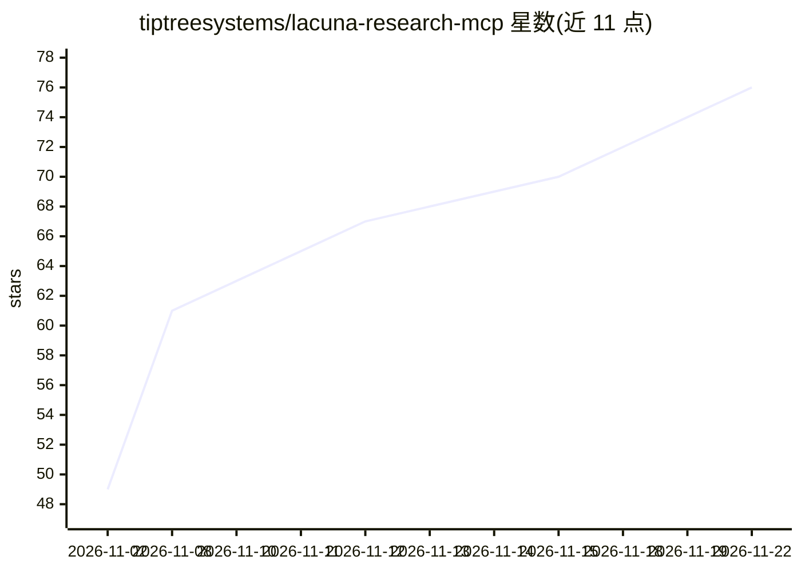

# tiptreesystems/lacuna-research-mcp

⭐ 76 · Python · MIT · 推送 2026-11-19 · [GitHub](https://github.com/tiptreesystems/lacuna-research-mcp) · [官网](https://lacuna.tiptreesystems.com) · 组织维护

**面向机器学习研究者的 MCP 服务器：检索 Lacuna 科研知识图谱**

由 Tiptree Systems 维护的 MCP 服务器，把 Lacuna 机器学习科研知识图谱（超 229 万论文、2.8 万研究方向、2.5 万生成式研究提案）接入 AI 研究者的编码代理。提供 search_lacuna、get_paper、get_direction、get_hypothesis 等工具，可检索论文、作者、机构、场所及与论文关联的代码库/数据集/模型，并追踪从派生对象到原始论文与页码的来源链。支持 Cursor/VS Code/Claude/Codex 等客户端，提供托管端点、PyPI 安装的本地 stdio/HTTP 服务器及可选研究技能包。生成式提案仅为待验证的研究想法，语料不覆盖非科研网络内容。

## 筛选速览

| 维度 | 判定 | 备注 |
|---|---|---|
| AI 角色 | `ai-knowledge` | 知识聚合/清单类 |
| 许可风险 | `permissive` | MIT |
| 部署形态 | `library` | 以包/库形式分发 |
| 模型依赖 | — | README 未给出锁定关系 |
| 硬件要求 | — | 无带数字的原话,不猜 |
| 安装摩擦 | `low` | 无编译、无系统依赖或容器化 |
| 成熟度 | — | 结构信号不足 |

## 能力要点

- 暴露 search_lacuna / get_paper / get_direction / get_hypothesis 等 MCP 工具
- 来源链可从派生对象回溯到具体论文与页码
- 支持托管端点（免本地安装）与 uvx 本地运行（stdio / Streamable HTTP）
- 覆盖超 229 万论文、21.5 万作者画像、2.8 万研究方向、5300+ 场所

## 适用场景

- 在编码代理中查证某仓库实现的原始论文与来源
- 实现新方法前检索相近已有工作与基线
- 浏览研究方向聚类的论文、作者与生成式研究提案
- 对比会议、机构与高产研究者的发表情况

## 场景标签

`科研工具` `知识图谱` · 领域:知识与检索

## 证据(README 行号)

> L9: Lacuna, built by Tiptree Systems, is a research map of machine learning: a heterogeneous knowledge graph linking pap
> L278: Lacuna's pipeline reconciles scholarly records from OpenAlex, OpenReview, DBLP, and arXiv; extracts concept elemen

## 星数曲线

2026-11-02 49 → 2026-11-22 76（+27）

---
*卡片 v1 · prompt 1.4 · 生成 2026-11-18 · 置信度 mid · 依据 README sha `66cd62776c08` · [字段定义](../../DATASET.md)*
