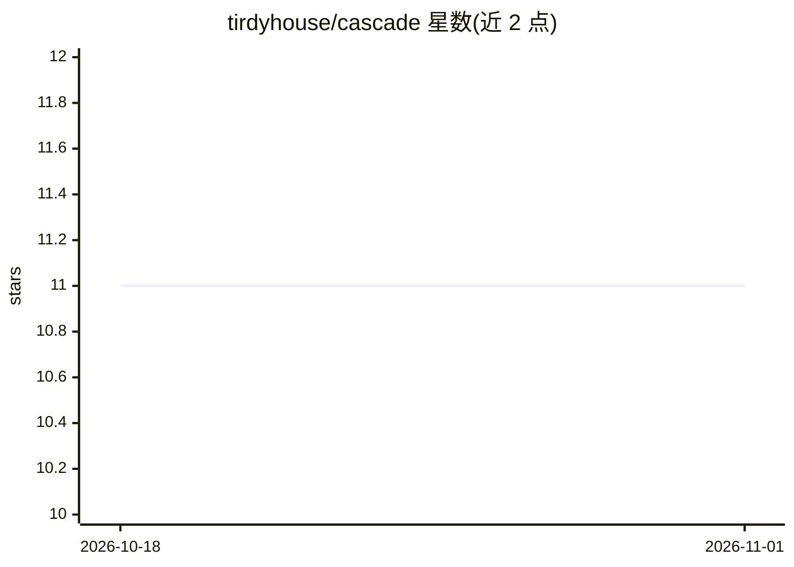

# tirdyhouse/cascade

⭐ 11 · Python · Apache-2.0 · 推送 2026-08-10 · [GitHub](https://github.com/tirdyhouse/cascade) · 个人维护 · 中文 README

**给推理运维者：用本地 NVMe 磁盘 KV 缓存扩展 vLLM 长上下文**

面向 vLLM 推理服务的磁盘级 KV 缓存层：将本地 NVMe 作为高容量 KV cache 层，通过 KVConnectorBase_V1 连接器保存/加载 KV 张量，元数据与 LRU 淘汰由独立的 Go 服务（Pebble 元数据、HTTP API）管理。提供 POSIX 便携后端与 GPUDirect Storage 后端（自动回退），在 A100 与 T4 上有验证记录；需禁用 vLLM 内置前缀缓存否则缓存不生效。含与 LMCache、Mooncake 的功能对比表，集群/池化 NVMe 尚在路线图阶段。安装方式为 make 源码构建，无预编译包。

## 筛选速览

| 维度 | 判定 | 备注 |
|---|---|---|
| AI 角色 | `ai-ecosystem` | LLM/agent 周边工具 |
| 许可风险 | `permissive` | Apache-2.0 |
| 部署形态 | `library` | 以包/库形式分发 |
| 模型依赖 | local-ok | 支持本地模型 |
| 硬件要求 | — | 无带数字的原话,不猜 |
| 安装摩擦 | `medium` | 含编译或系统依赖之一 |
| 成熟度 | `idea` | |

## 能力要点

- Go DiskCache 引擎：Pebble 元数据、LRU 淘汰、HTTP API
- POSIX 与 GPUDirect Storage (GDS) 双后端，GDS 自动回退 POSIX
- vLLM KVConnectorBase_V1 连接器，A100 + Qwen2.5-7B 实机验证
- OpenAI 兼容路由的集群网关 MVP（HA/分布式 GC 仍在规划）

## 适用场景

- 长提示与重复检索型对话场景下降低 GPU HBM 压力
- 在有限显存的主机上跑更长上下文的 vLLM 推理
- 利用本地 NVMe 缓存可复用 KV 块提升重复请求命中

## 场景标签

`推理引擎` · 领域:训练与推理

## 证据(README 行号)

> L5:  Disk-backed KV cache for long-context LLM inference.
> L6:  Extend vLLM beyond GPU memory with a Go metadata engine, POSIX/GDS storage backends, and a roadmap toward pooled NV
> L18: **Cascade** treats local NVMe as a first-class KV cache tier. It keeps the inference engine API surface small, move

## 星数曲线

2026-10-18 11 → 2026-11-01 11（+0）

---
*卡片 v1 · prompt 1.4 · 生成 2026-11-01 · 置信度 high · 依据 README sha `2b1c74191d0d` · [字段定义](../../DATASET.md)*
