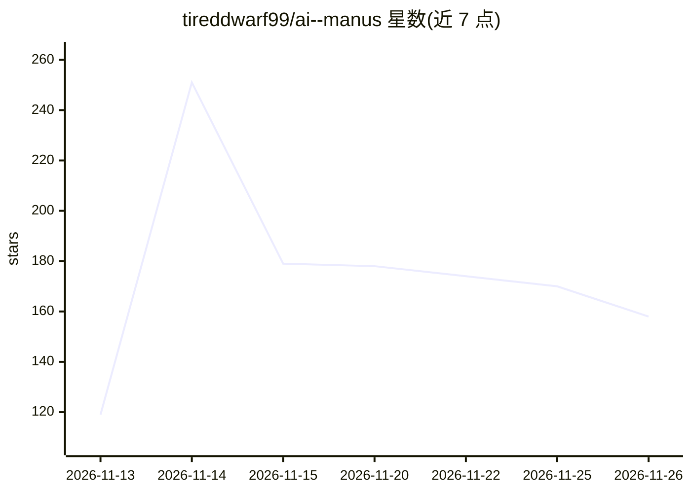

# tireddwarf99/ai--manus

⭐ 158 · Apache-2.0 · 推送 2026-11-14 · [GitHub](https://github.com/tireddwarf99/ai--manus) · 个人维护

**自主执行代码与控制浏览器的通用 AI Agent 助手**

README 描述的 Manus 是一个面向终端用户的自主 AI 代理：接收用户指令后自行编写并执行脚本、打开网页、填写表单、完成多步任务，代码执行与浏览器操作可在同一流程中衔接，并支持跨会话记住已设定的工作模式。定位为家庭、学习与轻量办公场景的个人助手，面向无需编程背景的用户。README 给出系统兼容性表（最低双核 CPU、4 GB 内存）与使用步骤说明，但未提供代码仓库结构、安装命令或依赖清单。

## 筛选速览

| 维度 | 判定 | 备注 |
|---|---|---|
| AI 角色 | `ai-native` | 本体是模型或模型工具 |
| 许可风险 | `permissive` | Apache-2.0 |
| 部署形态 | `None` |  |
| 模型依赖 | — | README 未给出锁定关系 |
| 硬件要求 | — | 无带数字的原话,不猜 |
| 安装摩擦 | `low` | 无编译、无系统依赖或容器化 |
| 成熟度 | — | 结构信号不足 |

## 能力要点

- 自主执行代码与浏览器控制相结合的多步任务执行
- 跨会话保持已设定的工作模式
- 面向非开发者的低门槛使用方式

## 适用场景

- 让代理代为完成重复性的网页操作与脚本执行
- 学习与研究中收集资料、运行小脚本、整理笔记
- 轻量办公中跨多页面收集信息并汇总

## 场景标签

`AI 助手` `浏览器自动化` `编码 Agent` · 领域:效率与自动化

## 证据(README 行号)

> L10: - **Autonomous Code Execution:** Manus AI agent runs code on its own to complete tasks, so you can focus on decisio
> L18: Manus is an autonomous AI agent designed to run code and control a browser on your behalf. Instead of acting like a

## 星数曲线

2026-11-13 119 → 2026-11-26 158（+39）

---
*卡片 v1 · prompt 1.4 · 生成 2026-11-17 · 置信度 mid · 依据 README sha `8234998f947a` · [字段定义](../../DATASET.md)*
