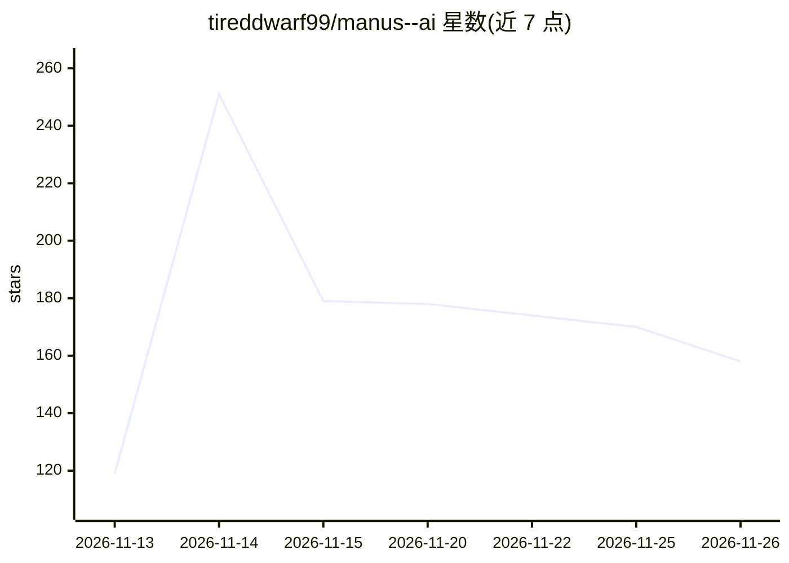

# tireddwarf99/manus--ai

⭐ 158 · Apache-2.0 · 推送 2026-11-14 · [GitHub](https://github.com/tireddwarf99/manus--ai) · 个人维护

**面向日常小任务的自定义 AI Agent：自主跑代码与控制浏览器**

README 描述的自定义 AI Agent 系统：在沙盒环境中自主编写并执行脚本、控制浏览器完成导航、填表、信息收集等多步骤任务，供学习、居家项目与轻量办公等场景使用。工作流为用户描述需求，agent 自行规划并执行步骤，支持脚本与浏览器操作衔接。README 未给出具体的安装命令、模型接入方式或代码运行说明，仅提供使用步骤建议与系统兼容性表格（最低 4GB 内存、双核 CPU）。

## 筛选速览

| 维度 | 判定 | 备注 |
|---|---|---|
| AI 角色 | `ai-native` | 本体是模型或模型工具 |
| 许可风险 | `permissive` | Apache-2.0 |
| 部署形态 | `None` |  |
| 模型依赖 | — | README 未给出锁定关系 |
| 硬件要求 | — | 无带数字的原话,不猜 |
| 安装摩擦 | `low` | 无编译、无系统依赖或容器化 |
| 成熟度 | — | 结构信号不足 |

## 能力要点

- 自主执行代码完成多步任务
- 浏览器控制：导航、填表、信息收集
- 脚本与浏览器操作可在同一流程中衔接

## 适用场景

- 让学生整理研究资料、跑小脚本
- 让 agent 代为浏览网页、跨页收集信息
- 自动化日常重复性小任务

## 场景标签

`编码 Agent` `浏览器自动化` · 领域:效率与自动化

## 证据(README 行号)

> L10: - **Autonomous Code Execution:** Manus AI agent runs code on its own to complete tasks, so you can focus on decisio
> L18: Manus is an autonomous AI agent designed to run code and control a browser on your behalf. Instead of acting like a

## 星数曲线

2026-11-13 119 → 2026-11-26 158（+39）

---
*卡片 v1 · prompt 1.4 · 生成 2026-11-17 · 置信度 mid · 依据 README sha `8234998f947a` · [字段定义](../../DATASET.md)*
