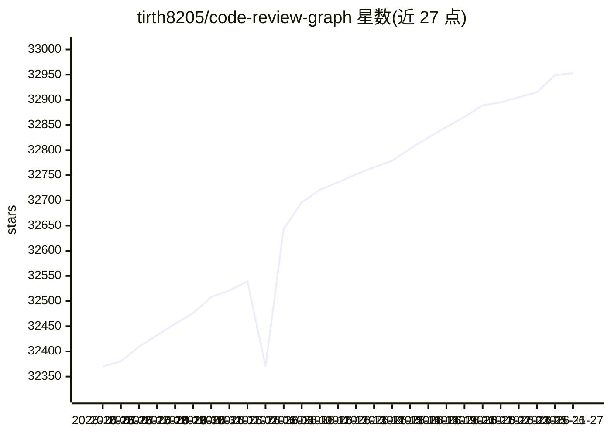

# tirth8205/code-review-graph

⭐ 32,953 · Python · MIT · 推送 2026-11-16 · [GitHub](https://github.com/tirth8205/code-review-graph) · [官网](https://code-review-graph.com) · 个人维护 · 中文 README

**为 AI 编码工具提供本地代码知识图谱的 MCP 服务与 CLI**

用 Tree-sitter 将代码库解析为函数、类、导入、调用与测试构成的持久图（SQLite 存储），通过 MCP 向 AI 编码工具返回与问题相关的最小文件集与影响范围分析。提供 install 命令自动检测本机的 AI 编码工具并写入 MCP 条目、钩子与技能配置，git/编辑器钩子与 watch 模式按 SHA-256 哈希增量更新图。数据保留在本机，云端嵌入为可选项。需 Python 3.10+，通过 PyPI 安装。

## 筛选速览

| 维度 | 判定 | 备注 |
|---|---|---|
| AI 角色 | `ai-ecosystem` | LLM/agent 周边工具 |
| 许可风险 | `permissive` | MIT |
| 部署形态 | `desktop` | 安装包/桌面程序 |
| 模型依赖 | — | README 未给出锁定关系 |
| 硬件要求 | — | 无带数字的原话,不猜 |
| 安装摩擦 | `low` | 无编译、无系统依赖或容器化 |
| 成熟度 | — | 结构信号不足 |

## 动量与使用信号

- 维护:`active` — 距上次 push 1.9 天,年发版 30,128 位贡献者
- 涨星:近 1 天 **+38**(自 20261016 起算)
- 安装:pypi 包 `code-review-graph` 月下载 301,897
- 平台:— · 协议:OPENAI-API / MCP / OLLAMA

## 能力要点

- Tree-sitter 解析多语言代码为节点/边图谱，SQLite 本地存储
- 影响范围分析：追踪变更可达的调用者、依赖者与测试并给出风险分
- git/编辑器钩子与 watch 模式增量更新（两文件编辑约 2.5 秒）
- 一条 install 命令自动配置 18 种 AI 编码工具平台

## 适用场景

- 让 AI 代码审查只读取变更涉及的文件，减少上下文消耗
- 在提交前查看一次改动可能波及的调用者与测试
- 大型仓库中为编码助手提供精简的代码结构上下文

## 场景标签

`代码审查` `知识图谱` · 领域:编码与开发

## 证据(README 行号)

> L12:  A local code knowledge graph that gives AI coding tools precise review context over MCP.
> L41: AI coding tools often re-read large parts of a codebase to review a change. `code-review-graph` builds a structural
> L92:  One install, every platform: detects Codex, Claude Code, CodeBuddy Code, Cursor, Windsurf, Zed, Continue, OpenCode

## 星数曲线

2026-10-25 32,370 → 2026-11-27 32,953（+583）

---
*卡片 v1 · prompt 1.4 · 生成 2026-11-22 · 置信度 mid · 依据 README sha `73911985eb6d` · [字段定义](../../DATASET.md)*
