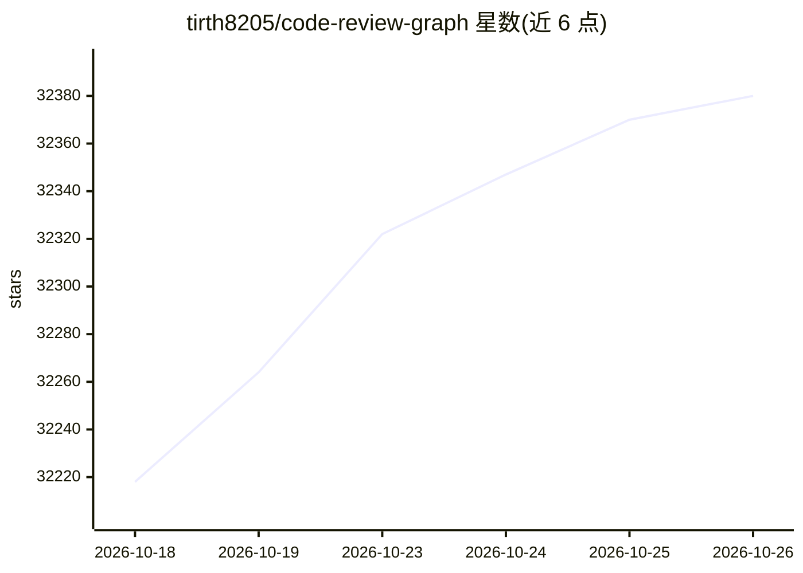

# tirth8205/code-review-graph

⭐ 32,380 · Python · MIT · 推送 2026-10-16 · [GitHub](https://github.com/tirth8205/code-review-graph) · [官网](https://code-review-graph.com) · 个人维护

**给 AI 编码工具的本地代码知识图谱：MCP 提供精准审查上下文**

用 Tree-sitter 将代码库解析为持久化图谱（函数/类/导入为节点，调用/继承/测试覆盖为边），存于 SQLite，并通过 MCP 服务器向 AI 编码工具提供紧凑上下文。变更时通过调用边追踪影响面（blast radius），让助手只读受影响文件；hooks、pre-commit 与 watch 模式基于 SHA-256 做增量更新。`install` 命令检测已装 AI 工具并写入 MCP 配置。同一分析可作为 GitHub Action 在 CI 中运行，附带可复现的 token 基准测试。需 Python 3.10+。

## 筛选速览

| 维度 | 判定 | 备注 |
|---|---|---|
| AI 角色 | `ai-ecosystem` | LLM/agent 周边工具 |
| 许可风险 | `permissive` | MIT |
| 部署形态 | `desktop` | 安装包/桌面程序 |
| 模型依赖 | — | README 未给出锁定关系 |
| 硬件要求 | — | 无带数字的原话,不猜 |
| 安装摩擦 | `low` | 无编译、无系统依赖或容器化 |
| 成熟度 | — | 结构信号不足 |

## 动量与使用信号

- 维护:`active` — 距上次 push 1.9 天,年发版 30,128 位贡献者
- 涨星:近 1 天 **+38**(自 20261016 起算)
- 安装:pypi 包 `code-review-graph` 月下载 301,897
- 平台:— · 协议:OPENAI-API / MCP / OLLAMA

## 能力要点

- Tree-sitter 解析 + SQLite 持久化图谱，覆盖 30+ 语言，可用 languages.toml 扩展
- blast-radius 分析返回变更影响的最小文件集
- hooks/watch 增量更新：~3,000 文件项目两文件编辑约 2.5 秒重建
- GitHub Action 形式的 PR 风险评分评论，可设 fail-on-risk 合并门禁

## 适用场景

- 让 AI 编码助手审查 PR 时只读受影响文件而非整个仓库
- 在 CI 中对每个 PR 生成风险评分函数清单与测试缺口
- 管理大型多语言仓库中 AI 问答的 token 消耗

## 场景标签

`代码审查` `知识图谱` · 领域:编码与开发

## 证据(README 行号)

> L12:  A local code knowledge graph that gives AI coding tools precise review context over MCP.
> L38: AI coding tools often re-read large parts of a codebase to review a change. `code-review-graph` builds a structural
> L86: The repository is parsed into ASTs with Tree-sitter and stored as a graph of nodes (functions, classes, imports) an

## 星数曲线

2026-10-18 32,218 → 2026-10-26 32,380（+162）

---
*卡片 v1 · prompt 1.4 · 生成 2026-10-18 · 置信度 high · 依据 README sha `09a527ca5631` · [字段定义](../../DATASET.md)*
