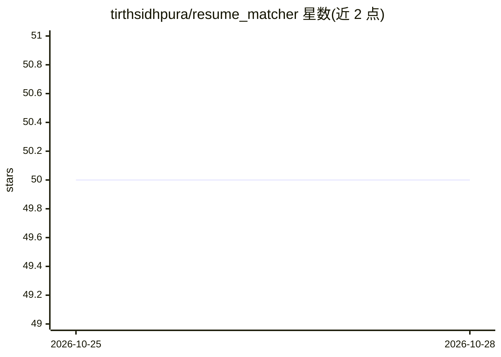

# tirthsidhpura/resume_matcher

⭐ 50 · JavaScript · 推送 2026-10-04 · [GitHub](https://github.com/tirthsidhpura/resume_matcher) · 个人维护

**本地运行的简历-职位 ATS 匹配工具：抓取招聘信息并评分**

面向求职者的本地托管 Web 应用：从 LinkedIn/Indeed 采集职位信息，解析用户上传的 PDF/DOCX 简历，通过可配置的本地或外部 AI 服务对每个职位生成 0-100 匹配分、matched/missing 关键词、技能差距与是否建议投递的判定（≥72 为 GOOD TO APPLY）。分析任务经 Redis+BullMQ 异步处理，附 Bull Board 队列监控。技术栈为 Node.js/Express/MongoDB，通过 Docker Compose 一键启动，简历数据默认保留在本地。限制：爬虫选择器可能随招聘网站改版失效，需自行更新。

## 筛选速览

| 维度 | 判定 | 备注 |
|---|---|---|
| AI 角色 | `ai-native` | 本体是模型或模型工具 |
| 许可风险 | `none` | — |
| 部署形态 | `self-host` | docker 或自建部署 |
| 模型依赖 | — | README 未给出锁定关系 |
| 硬件要求 | — | 无带数字的原话,不猜 |
| 安装摩擦 | `low` | 无编译、无系统依赖或容器化 |
| 成熟度 | — | 结构信号不足 |

## 能力要点

- ATS 匹配分（0-100）与投递建议（≥72 判定 GOOD TO APPLY）
- LinkedIn/Indeed 职位采集与本地职位库管理
- PDF 简历解析，提取技能/经历/关键词
- Redis+BullMQ 异步分析队列与 Bull Board 监控面板

## 适用场景

- 投递前批量评估职位与简历的匹配度并排序
- 查看每个职位缺失的关键词与技能以针对性修改简历
- 本地保存感兴趣的职位并跟踪分析结果

## 场景标签

 · 领域:求职/人力资源工具

## 证据(README 行号)

> L3: A locally hosted resume-matching application that collects job postings, analyzes them against a user’s resume, and 
> L71: Each job description is compared against the uploaded resume using an AI analysis service.

## 星数曲线

2026-10-25 50 → 2026-10-28 50（+0）

---
*卡片 v1 · prompt 1.4 · 生成 2026-10-24 · 置信度 high · 依据 README sha `3bbd82ab9115` · [字段定义](../../DATASET.md)*
