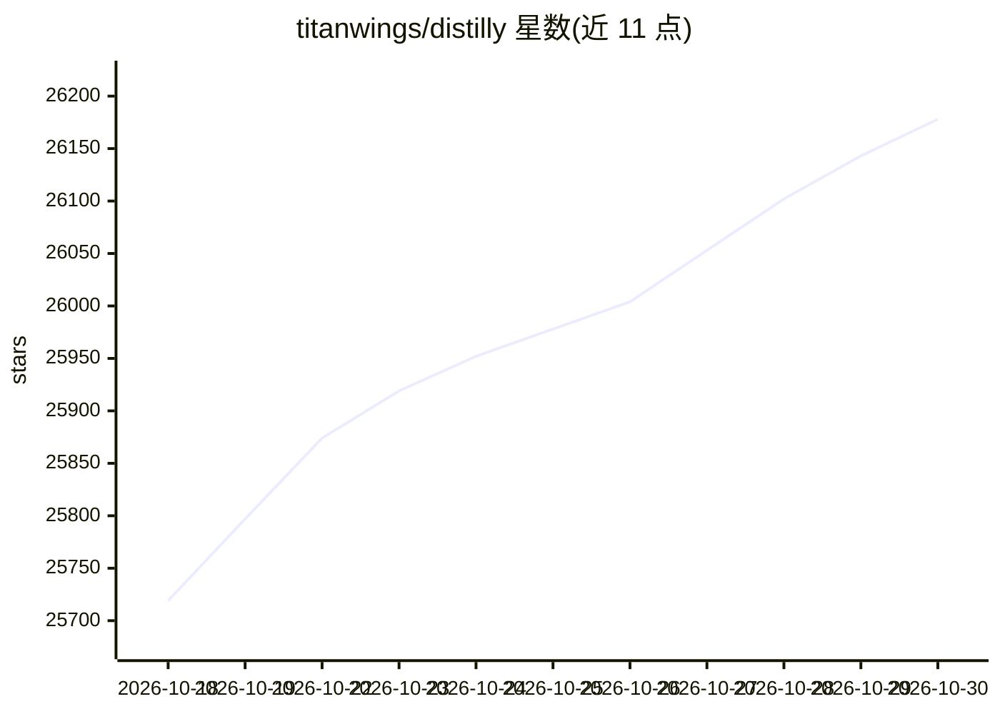

# titanwings/distilly

⭐ 26,178 · Python · MIT · 推送 2026-10-13 · [GitHub](https://github.com/titanwings/distilly) · 个人维护 · 中文 README

**把人物经验沉淀为可复用 Agent 技能的人物建模工具**

从聊天记录、文档、访谈、公开资料等素材中提炼人物的经验、判断与表达方式，生成可移植、有出处依据的 Person Profile，并打包为 Agent Skill 供兼容宿主安装调用。覆盖同事、关系、名人三类人物族，各有人物素材收集策略与分析维度。支持八种 Agent 宿主的本地 Skill 发现，数据源包括 Lark、钉钉、Slack、微信（经 WeChatMsg/PyWxDump 导出）、邮件与手动上传。安装方式为将仓库克隆到宿主的 Skills 目录。README 注明当前仍为 demo 版本。

## 筛选速览

| 维度 | 判定 | 备注 |
|---|---|---|
| AI 角色 | `ai-native` | 本体是模型或模型工具 |
| 许可风险 | `permissive` | MIT |
| 部署形态 | `None` |  |
| 模型依赖 | — | README 未给出锁定关系 |
| 硬件要求 | — | 无带数字的原话,不猜 |
| 安装摩擦 | `low` | 无编译、无系统依赖或容器化 |
| 成熟度 | `idea` | |

## 动量与使用信号

- 维护:`active` — 距上次 push 5.1 天,年发版 1,4 位贡献者
- 涨星:近 1 天 **+42**(自 20261016 起算)

## 能力要点

- 三类人物族（colleague/relationship/celebrity）单一工作流生成 Person Profile
- 支持 Claude Code、Codex、DeepSeek Harness 等八种 Agent 宿主的本地 Skill 发现
- 数据源覆盖 Lark/钉钉/Slack API、微信聊天记录 SQLite、PDF/邮件/Markdown 手动上传
- 生成的 Skill 支持 delta 合并、对话纠正写入 Correction 层、自动版本归档回滚

## 适用场景

- 同事离职前沉淀其工作流程与判断方式供团队 Agent 复用
- 整理与家人朋友的聊天记录生成关系型 Persona Skill
- 基于公开访谈与著作为公众人物构建研究型 Profile

## 场景标签

 · 领域:AI Agent 生态/技能生成

## 证据(README 行号)

> L24: Distilly is the person-modeling layer for agents. It turns the materials you provide into a portable, source-ground
> L74: The old version only ran in Claude Code. Distilly now supports native local Skill discovery across eight agent host
> L88: Each generated Person Profile is packaged as an Agent Skill and can be installed into any supported host.

## 星数曲线

2026-10-18 25,719 → 2026-10-30 26,178（+459）

---
*卡片 v1 · prompt 1.4 · 生成 2026-10-18 · 置信度 high · 依据 README sha `0b8fe4e41b68` · [字段定义](../../DATASET.md)*
