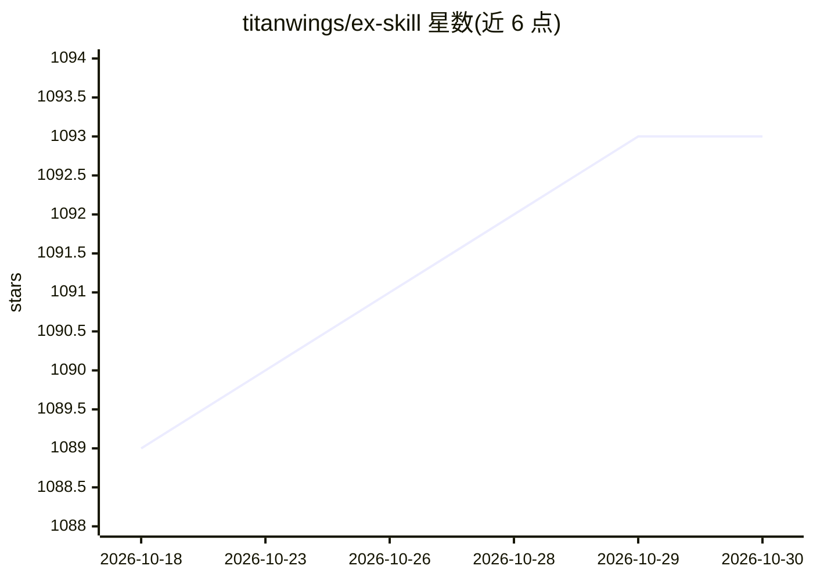

# titanwings/ex-skill

⭐ 1,093 · Python · MIT · 推送 2026-08-13 · [GitHub](https://github.com/titanwings/ex-skill) · 个人维护 · 中文 README

**用聊天记录生成前任数字人格 Skill，可对话的复刻**

面向 AgentSkills 生态的人格生成技能：读取微信/iMessage 聊天记录（Windows/macOS 自动解密提取）或截图、粘贴文本，结合性别、MBTI、依恋类型、星座等描述，生成 6 层人格结构的数字前任 Skill，之后可用 /{slug} 与其对话。技能安装到 OpenClaw、Claude Code、DeepSeek Harness 后运行，支持增量导入消息、对话式纠错、版本回滚与多前任独立存储。README 自述仍为 beta/demo 阶段，自动解密可能存在 bug。

## 筛选速览

| 维度 | 判定 | 备注 |
|---|---|---|
| AI 角色 | `ai-native` | 本体是模型或模型工具 |
| 许可风险 | `permissive` | MIT |
| 部署形态 | `library` | 以包/库形式分发 |
| 模型依赖 | locked-api |  |
| 硬件要求 | — | 无带数字的原话,不猜 |
| 安装摩擦 | `low` | 无编译、无系统依赖或容器化 |
| 成熟度 | `idea` | |

## 能力要点

- 微信/iMessage 聊天记录自动解密提取（SQLite）
- 6 层人格结构（核心规则/身份/表达/情绪/冲突边界/触发器）
- 增量更新、纠错层写入、版本归档与回滚
- 兼容 OpenClaw / Claude Code / DeepSeek Harness 的 SKILL.md 标准

## 适用场景

- 用真实聊天记录生成前任的数字人格并继续对话
- 结合 MBTI、依恋类型等标签定制人格行为
- 增量补充聊天记录逐步修正人格表现

## 场景标签

`聊天机器人` · 领域:对话与助手

## 证据(README 行号)

> L22: Generate a **digital persona Skill that truly feels like them**
> L102: Once created, use `/{slug}` to talk to them.

## 星数曲线

2026-10-18 1,089 → 2026-10-30 1,093（+4）

---
*卡片 v1 · prompt 1.4 · 生成 2026-10-21 · 置信度 mid · 依据 README sha `db903180d679` · [字段定义](../../DATASET.md)*
