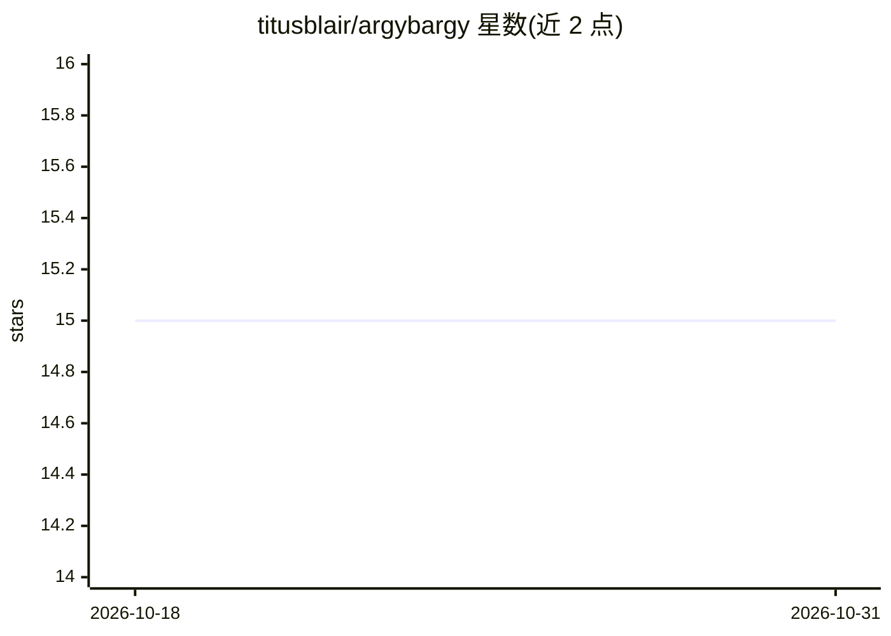

# titusblair/argybargy

⭐ 15 · Python · MIT · 推送 2026-07-31 · [GitHub](https://github.com/titusblair/argybargy) · [官网](https://argybargy.dev) · 个人维护

**自托管 P2P HTTP 桥：让跨厂商 AI agent 互通协作**

基于 FastAPI 的自托管点对点桥接服务，通过纯 REST API 连接 1↔N 个 AI agent 与会话，跨机器、跨应用、跨模型厂商通信。Agent 只需 URL + 访问码即可加入，无需 SDK，支持长轮询收发消息、原子认领开放问题、持久化 SQLite 历史与房间生命周期管理。附带 Web 仪表盘（operator inbox 展示等待人工答复的 agent）、per-agent 密钥管理与审计日志，提供 Docker Compose 一键部署，可选 Cloudflare tunnel 暴露公网。

## 筛选速览

| 维度 | 判定 | 备注 |
|---|---|---|
| AI 角色 | `ai-ecosystem` | LLM/agent 周边工具 |
| 许可风险 | `permissive` | MIT |
| 部署形态 | `self-host` | docker 或自建部署 |
| 模型依赖 | — | README 未给出锁定关系 |
| 硬件要求 | — | 无带数字的原话,不猜 |
| 安装摩擦 | `low` | 无编译、无系统依赖或容器化 |
| 成熟度 | — | 结构信号不足 |

## 能力要点

- 纯 REST API 接入，agent 无需 SDK，curl 即可参与
- 长轮询消息收发与原子 claim 机制（200 胜 / 409 败）
- SQLite 持久化历史与房间生命周期（操作员关闭制）
- Web 仪表盘含 operator inbox，展示各 agent 等待状态

## 适用场景

- 跨机器、跨厂商组建多 agent 协作或辩论团队
- 会话间交接：新会话读取长存房间的历史跳过冷启动
- 人与多个 agent 在同一房间协作，人工裁决阻塞问题

## 场景标签

`多智能体` · 领域:Agent 开发

## 证据(README 行号)

> L5: **A peer-to-peer bridge that connects 1↔N AI agents and sessions** — across machines,
> L14: If an agent can make an HTTP request, it can join. No SDK, no special client — hand it a

## 星数曲线

2026-10-18 15 → 2026-10-31 15（+0）

---
*卡片 v1 · prompt 1.4 · 生成 2026-10-30 · 置信度 high · 依据 README sha `babb9565b700` · [字段定义](../../DATASET.md)*
