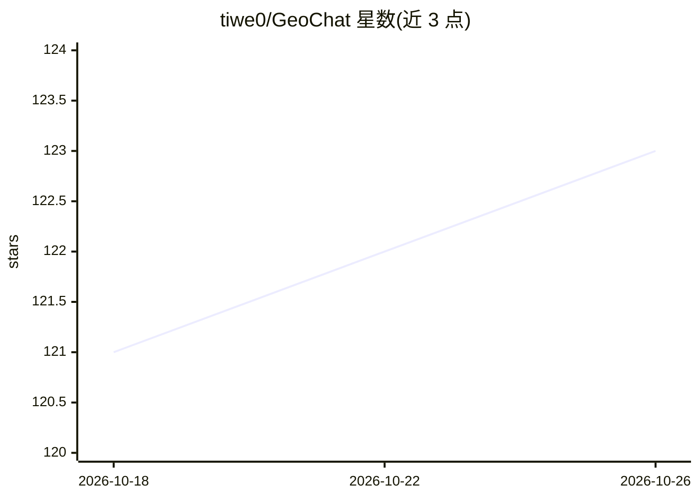

# tiwe0/GeoChat

⭐ 123 · TypeScript · Apache-2.0 · 推送 2026-10-22 · [GitHub](https://github.com/tiwe0/GeoChat) · [官网](https://chat-with-geogebra.com) · 个人维护 · 中文 README

**让 AI 对话融入 GeoGebra 画板的数学学习桌面应用**

面向数学学习、教学与探索的本地优先桌面应用（Tauri/React/Bun），将 AI 对话嵌入 GeoGebra 画板：用自然语言发起 2D/3D 构造，读取画板与选中对象，组织作图步骤、调用 GeoGebra、检查结果并给出带 LaTeX 排版的讲解卡片。提供融合模式与窗口模式、内置题库、数学技能自动匹配，支持 DeepSeek/OpenAI/Anthropic/Gemini/OpenRouter/通义千问及自定义协议服务，自带密钥模式，核心功能不要求登录在线账户。另有 DeepSeek Harness 插件（含 55 个数学技能与离线画布资源）。提供 macOS/Windows 安装包。

## 筛选速览

| 维度 | 判定 | 备注 |
|---|---|---|
| AI 角色 | `ai-native` | 本体是模型或模型工具 |
| 许可风险 | `permissive` | Apache-2.0 |
| 部署形态 | `None` |  |
| 模型依赖 | locked-api |  |
| 硬件要求 | — | 无带数字的原话,不猜 |
| 安装摩擦 | `low` | 无编译、无系统依赖或容器化 |
| 成熟度 | — | 结构信号不足 |

## 能力要点

- 自然语言驱动 GeoGebra 2D/3D 作图并检查结果
- 融合模式：输入框在画板任意位置唤起，回答与图形空间关联
- 多模型支持与自定义 OpenAI/Anthropic/Google 协议服务接入
- DeepSeek Harness 插件内置 55 个数学技能与离线画布资源

## 适用场景

- 把抽象数学题变成可观察、可操作的图形并逐步讲解
- 课堂教学中快速生成构造、动画与讲解步骤
- 几何探索中修改条件、移动对象并观察结果变化
- 不离开画板浏览题库并结合图形完成推导验证

## 场景标签

 · 领域:数学教育/桌面工具

## 证据(README 行号)

> L37: GeoChat 是一款面向数学学习、教学与探索的 AI GeoGebra 助手。
> L73: 从基础函数、平面几何到空间几何，都可以通过自然语言发起构造。GeoChat 会组织作图
> L103: 支持 DeepSeek、OpenAI、Anthropic Claude、Google Gemini、OpenRouter、通义千问，

## 星数曲线

2026-10-18 121 → 2026-10-26 123（+2）

---
*卡片 v1 · prompt 1.4 · 生成 2026-10-23 · 置信度 high · 依据 README sha `95268872b315` · [字段定义](../../DATASET.md)*
