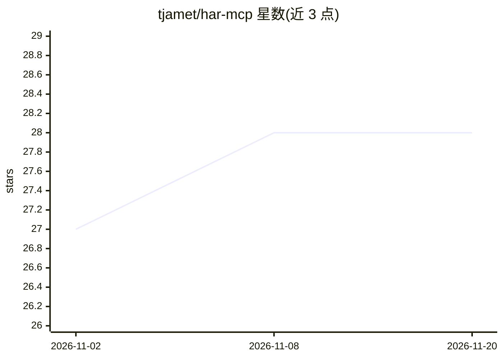

# tjamet/har-mcp

⭐ 28 · Go · MIT · 推送 2026-11-02 · [GitHub](https://github.com/tjamet/har-mcp) · 个人维护

**供 AI 助手解析分析 HAR 网络抓包文件的 MCP 服务器**

基于 stdio 与 JSON-RPC 的 MCP 服务器，用 Go 编写，让 Claude Desktop 等 AI 助手读取并分析浏览器导出的 HAR（HTTP Archive）文件。提供 4 个工具：加载本地或 HTTP URL 的 HAR 文件、列出全部 URL 与 HTTP 方法、按 URL/方法查询请求 ID、按 ID 取回完整请求详情，并自动脱敏 Authorization、Cookie 等认证头。解析层兼容真实世界 HAR 文件的浮点时间字段、base64 响应内容等非规范扩展。安装途径为 Docker、go run 或 go build 源码编译。

## 筛选速览

| 维度 | 判定 | 备注 |
|---|---|---|
| AI 角色 | `ai-ecosystem` | LLM/agent 周边工具 |
| 许可风险 | `permissive` | MIT |
| 部署形态 | `None` |  |
| 模型依赖 | — | README 未给出锁定关系 |
| 硬件要求 | — | 无带数字的原话,不猜 |
| 安装摩擦 | `low` | 无编译、无系统依赖或容器化 |
| 成熟度 | — | 结构信号不足 |

## 能力要点

- 4 个 MCP 工具：加载 HAR、列出 URL/方法、查询请求 ID、取回请求详情
- 自动脱敏 Authorization/X-API-Key/Cookie 等 6 类认证头
- 兼容含浮点时间字段、base64 内容等扩展的真实 HAR 文件
- 支持从本地文件路径或 HTTP URL 加载

## 适用场景

- 让 Claude 等 AI 助手直接分析浏览器抓包的网络流量
- 调试 API 时把 HAR 交给 AI 助手逐条排查请求
- 安全地让 AI 检查网络请求而认证凭据被自动脱敏

## 场景标签

`文档解析` · 领域:知识与检索

## 证据(README 行号)

> L3: A Model Context Protocol (MCP) server for parsing and analyzing HAR (HTTP Archive) files. This server allows AI assi
> L58: The HAR MCP server runs as a stdio-based MCP server, communicating via JSON-RPC over standard input/output.

## 星数曲线

2026-11-02 27 → 2026-11-20 28（+1）

---
*卡片 v1 · prompt 1.4 · 生成 2026-11-18 · 置信度 high · 依据 README sha `a602f29421bd` · [字段定义](../../DATASET.md)*
