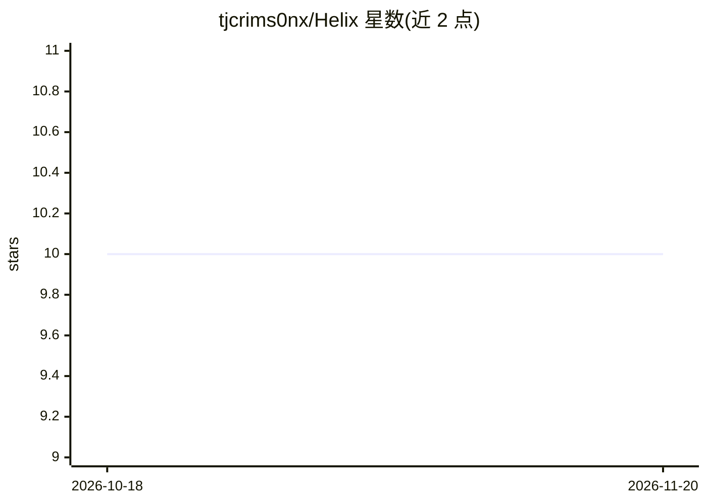

# tjcrims0nx/Helix

⭐ 10 · Rust · 推送 2026-11-13 · [GitHub](https://github.com/tjcrims0nx/Helix) · 个人维护

**本地优先的桌面 AI 聊天壳，在本机运行 GGUF 模型**

基于 Tauri 2 + Rust + Vue 3 的桌面聊天应用，内置 llama.cpp 的 llama-server 引擎，支持 Vulkan GPU 加速与 FlashAttention，在本地硬件直接运行 GGUF 模型，无需云端服务、API key 或后台守护进程。提供模型管理（HuggingFace GGUF 搜索、并行分块下载、本地导入）、动态上下文窗口协商、MCP 插件系统（stdio/SSE、/mcp 斜杠命令）、文件附件与硬件监控。当前提供 Windows 安装包（NSIS/MSI）；开发运行需 Node.js 18+ 与 Rust 1.77+。

## 筛选速览

| 维度 | 判定 | 备注 |
|---|---|---|
| AI 角色 | `ai-native` | 本体是模型或模型工具 |
| 许可风险 | `none` | — |
| 部署形态 | `desktop` | 安装包/桌面程序 |
| 模型依赖 | local-ok | 支持本地模型 |
| 硬件要求 | — | 无带数字的原话,不猜 |
| 安装摩擦 | `low` | 无编译、无系统依赖或容器化 |
| 成熟度 | — | 结构信号不足 |

## 能力要点

- 内置 llama.cpp 引擎，Vulkan GPU 加速与 FlashAttention
- HuggingFace GGUF 搜索、8 流并行下载与断点续传
- MCP 插件系统：stdio/SSE 接入、/mcp 斜杠命令、配置导入
- 上下文窗口按硬件自动协商（131072→8192）

## 适用场景

- 在本地硬件离线运行 GGUF 模型进行私密对话
- 从 HuggingFace 搜索下载并管理本地模型库
- 通过 MCP 插件为聊天接入文件系统工具与自定义 agent 技能

## 场景标签

`聊天机器人` `推理引擎` · 领域:对话与助手

## 证据(README 行号)

> L5: HELIX provides a standalone, private desktop chat environment. Run local GGUF models directly on your hardware witho
> L104: - Direct execution via built-in `llama-server` engine.

## 星数曲线

2026-10-18 10 → 2026-11-20 10（+0）

---
*卡片 v1 · prompt 1.4 · 生成 2026-11-19 · 置信度 high · 依据 README sha `408a7862126f` · [字段定义](../../DATASET.md)*
